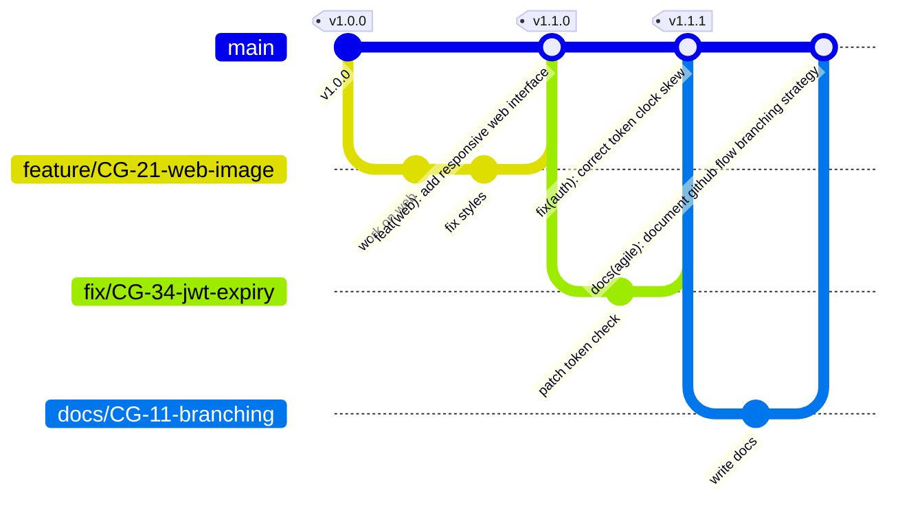

# Estrategia de Branching y Gestión de Cambios en Git

CircleGuard adopta una estrategia de versionado y branching basada en **GitHub Flow**, optimizada para integración continua (CI) y entrega continua (CD) con despliegues automatizados mediante Jenkins.

---

## 1. Filosofía de GitHub Flow

En CircleGuard, el flujo de desarrollo se fundamenta en un modelo basado en tronco simplificado:

1. **`main` es la rama principal**: representa siempre el estado funcional y desplegable del sistema. Todo commit que llega a `main` debe superar la suite de integración continua y es candidato inmediato a despliegue.
2. **Ciclo de vida corto de ramas**: cada cambio (funcionalidad, corrección o documentación) se desarrolla en una rama corta creada directamente desde `main`.
3. **Integración mediante Pull Requests (PR)**: ningún desarrollador realiza push directo a `main`. Todo cambio se somete a revisión y validación automatizada mediante un PR.
4. **Despliegue guiado por pipeline**: la integración a `main` desencadena la publicación de artefactos inmutables y su promoción controlada a los ambientes de desarrollo (`dev`), pruebas (`stage`) y producción (`prod`).

### Protección de la rama `main` (Ruleset de GitHub)

Para garantizar la estabilidad e integridad del repositorio, la rama `main` cuenta con un conjunto de reglas obligatorias (*Ruleset*):
- **Pull Request obligatorio**: no se permiten commits directos en `main`.
- **Revisión y aprobación obligatoria**: requiere como mínimo la aprobación formal (1 approval) de otro miembro del equipo antes de autorizar el merge.
- **Historial estrictamente lineal (*Require linear history*)**: se rechazan merges de tres vías o merge commits tradicionales.
- **Sin Force Push**: prohibido el uso de `git push --force` o `--force-with-lease` sobre `main`.
- **Sin borrado**: prohibido eliminar la rama `main`.
- **Status check de Jenkins obligatorio**: el pipeline de validación CI ejecutado en Jenkins debe reportar estado exitoso (*green build*) para habilitar el merge del PR.

---

## 2. Convención de Ramas

Toda rama de trabajo debe crearse a partir de `main` actualizado y nombrarse siguiendo el estándar:

```text
<tipo>/CG-<n>-short-description
```

### Componentes de la nomenclatura

- **`<tipo>`**: categoría del cambio según el vocabulario estandarizado.
- **`CG-<n>`**: identificador único de la tarjeta o issue en el backlog del proyecto (ej. `CG-11`, `CG-16`).
- **`short-description`**: descripción concisa del propósito de la rama en inglés, en minúsculas y separada por guiones (*kebab-case*).

### Tipos de ramas permitidos

| Tipo | Propósito | Ejemplo |
|---|---|---|
| `feature` | Nuevas capacidades, casos de uso o endpoints en microservicios o frontend. | `feature/CG-21-web-image` |
| `fix` | Corrección de fallos, bugs o comportamientos anómalos en código existente. | `fix/CG-34-jwt-expiration-handling` |
| `docs` | Modificaciones o adiciones en documentación técnica, diagramas o guías. | `docs/CG-11-branching-strategy` |
| `chore` | Tareas de mantenimiento, dependencias o configuración sin impacto funcional. | `chore/CG-9-gitignore-setup` |
| `ci` | Cambios en configuración de Jenkins, pipelines, shared libraries o scripts de despliegue. | `ci/CG-12-multibranch-pipeline` |
| `test` | Incorporación o refactorización de pruebas unitarias, de integración o E2E. | `test/CG-45-promotion-load-tests` |
| `build` | Cambios en Gradle, Dockerfiles o herramientas de empaquetamiento. | `build/CG-50-upgrade-spring-boot` |

---

## 3. Conventional Commits y Efecto en el Versionado

El repositorio adopta la especificación [Conventional Commits v1.0.0](https://www.conventionalcommits.org/) en idioma **inglés** y modo imperativo. 

La herramienta `git-cliff` inspecciona el historial de commits en `main` para determinar automáticamente la siguiente versión semántica ([SemVer](https://semver.org/)) y redactar las notas de lanzamiento (*Release Notes*).

### Formato de commit

```text
<tipo>(<alcance opcional>): <descripción concisa en imperativo y minúsculas>

[cuerpo explicativo opcional]

[pie de página con referencias a issues o breaking changes]
```

### Matriz de tipos y efecto en la versión (SemVer)

| Tipo de commit | Efecto en versión | Regla en `cliff.toml` | Descripción y ejemplos |
|---|---|---|---|
| `feat` | **MINOR** (`v1.0.0` → `v1.1.0`) | `features_always_bump_minor = true` | Introduce una nueva funcionalidad en el sistema.<br>Ejemplo: `feat(auth): add ldap institutional login` |
| `fix` | **PATCH** (`v1.0.0` → `v1.0.1`) | Parsed as Bug Fixes | Corrige un error o defecto en producción.<br>Ejemplo: `fix(qr): correct timestamp offset in validation` |
| `perf` | **PATCH** (`v1.0.0` → `v1.0.1`) | Parsed as Performance | Optimización de rendimiento de base de datos o cómputo.<br>Ejemplo: `perf(promotion): batch update status in redis` |
| `refactor` | **PATCH** (`v1.0.0` → `v1.0.1`) | Parsed as Refactor | Modificación estructural del código sin cambiar su comportamiento observable.<br>Ejemplo: `refactor(gateway): extract token claims validator` |
| `build` | **PATCH** (`v1.0.0` → `v1.0.1`) | Parsed as Build System | Modificaciones en compilación Gradle o dependencias operativas.<br>Ejemplo: `build(deps): update testcontainers to 1.19.7` |
| `!` o `BREAKING CHANGE:` | **MAJOR** (`v1.0.0` → `v2.0.0`) | `breaking_always_bump_major = true` | Cambios incompatibles hacia atrás en contratos de API o esquema de datos.<br>Ejemplo: `feat(api)!: migrate v1 auth endpoints to v2 format` |
| `docs` | **Sin release** (Skip) | `skip = true` | Cambios exclusivamente documentales.<br>Ejemplo: `docs(arch): map service ports and env vars` |
| `chore` | **Sin release** (Skip) | `skip = true` | Tareas rutinarias que no afectan el binario publicado.<br>Ejemplo: `chore: update linter rules` |
| `ci` | **Sin release** (Skip) | `skip = true` | Ajustes en pipelines o configuración de CI/CD.<br>Ejemplo: `ci(jenkins): adjust timeout for prod approval` |
| `test` | **Sin release** (Skip) | `skip = true` | Creación o mantenimiento de pruebas automatizadas.<br>Ejemplo: `test(auth): add mock ldap integration test` |
| `style` | **Sin release** (Skip) | `skip = true` | Ajustes de formato, espacios en blanco o puntuación.<br>Ejemplo: `style: reorder import statements` |

---

## 4. Squash Merge y su Rol Crítico en el Historial

Al completar la revisión y aprobar un Pull Request, la integración a `main` se realiza exclusivamente mediante **Squash and Merge**.

### Principios del Squash Merge:
1. **Un PR = Un Commit en `main`**: todos los commits exploratorios, ajustes intermedios o correcciones menores realizados en la rama de trabajo se combinan en un único commit atómico.
2. **El título del PR define el commit de `main`**: GitHub toma el título del Pull Request como mensaje del commit aplastado.
3. **Alimentación directa de `git-cliff`**: dado que `git-cliff` opera sobre los commits de `main`, **el título del PR es exactamente la entrada que determina el bump de versión y la línea en el Changelog**.
4. **Requisito estricto**: el título de todo PR debe seguir obligatoriamente la convención Conventional Commits (por ejemplo: `feat(web): add anonymous symptom reporting view`).

---

## 5. Justificación: ¿Por qué NO existe una rama `dev`?

A diferencia de modelos tradicionales como GitFlow (que mantienen ramas `develop`, `release/*` y `main`), CircleGuard adopta el principio moderno de entrega continua:

### 1. Principio "Build Once, Deploy Everywhere"
- El pipeline compila el código fuente, ejecuta las pruebas y construye los contenedores Docker **una sola vez** a partir del commit integrado en `main`.
- La imagen Docker resultante es **inmutable** y se etiqueta con el número de versión SemVer correspondiente (por ejemplo: `circleguard/promotion-service:v1.1.0`). Nunca se utiliza la etiqueta mutable `latest`.
- Esta misma imagen exacta se despliega secuencialmente en `dev`, luego en `stage` y finalmente en `prod`.

### 2. Eliminación de la "Deriva de Ramas" (*Branch Drift*)
- Mantener ramas separadas para cada ambiente introduce divergencias de código: una versión probada en la rama `dev` puede comportarse de manera diferente al integrarse a `release` o `main` debido a merges conflictivos o desincronización de dependencias.
- Al usar únicamente `main`, lo que se prueba en `dev` y `stage` es bit por bit idéntico a lo que entrará en `prod`.

### 3. Diferenciación exclusiva por configuración en tiempo de ejecución
- La variabilidad entre ambientes no radica en el código, sino en su configuración externa: cadenas de conexión a bases de datos, claves secretas, endpoints de servicios y niveles de log.
- Estas variaciones se suministran mediante variables de entorno (*relaxed binding*) inyectadas en los archivos `docker-compose` de cada servidor (`dev`, `stage`, `prod`), preservando la inmutabilidad de los artefactos.

---

## 6. Diagrama de Flujo Git (gitGraph)

El siguiente diagrama ilustra el flujo de trabajo: desarrollo en ramas cortas, squash merge hacia `main`, disparo de versión y etiquetado automático:


