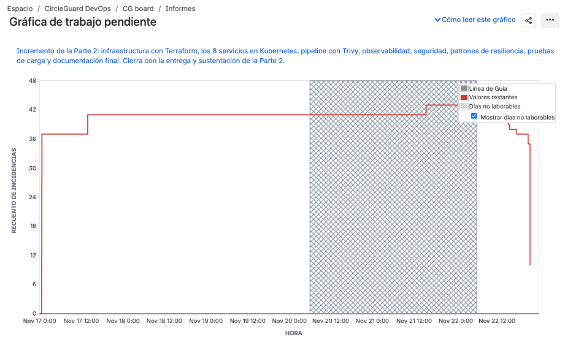

# Sprint 2: Kubernetes, Convención de Versiones, Resiliencia y Documentación Final

**Periodo:** 17 al 22 de noviembre de 2026  
**Marco de trabajo:** Scrum adaptado para entregas de alta intensidad técnica  
**Proyecto:** CircleGuard (Monorepo Spring Boot 3.2 / Java 21 y React Native Expo)  
**Organización en GitHub:** `ingesoft5`  
**Proyecto Jira:** `CG`  
**Entrega final:** domingo 22 de noviembre de 2026, 23:59 (America/Bogota)

---

## 1. Planeación del Sprint 2

### 1.1 Objetivo del Sprint
Llevar los 8 microservicios y el cliente web desde Docker Compose (Parte 1) a un clúster Kubernetes (k3s) aprovisionado con Terraform, desplegado con Helm y alimentado por el pipeline de Jenkins hasta `circleguard-dev`. Además, cerrar las observaciones del profesor sobre la sustentación de la Parte 1: limitar el tamaño de los Pull Requests con una regla automática y separar con claridad las versiones sin validar (`SNAPSHOT`) de las releases (`vX.Y.Z`). Por último, incorporar tres patrones de diseño (Circuit Breaker, Retry y Feature Toggle), documentar la arquitectura y los costos, y producir el informe final, el resumen ejecutivo y la presentación.

### 1.2 Reparto por persona (Story Points)
La estimación de puntos proviene del tablero de Jira (campo "Story point estimate"). Los valores de Darío y Simón se mantuvieron; el de Luis resultó de 40 puntos al cierre (ver 4.2).

| Integrante | Rol en el sprint | Story Points | Historias principales |
|---|---|:---:|---|
| **Darío** | Infraestructura y pruebas | **51** | Terraform para k3s (red, clúster, registro y almacenamiento), chart de Helm, namespaces, ConfigMap (CG-82), reportes de Locust y ZAP (H4), y limpieza de SNAPSHOT viejos en Nexus (CG-117). |
| **Simón** | Pipeline Jenkins | **47** | Convención SNAPSHOT en el pipeline (CG-116), despliegue a Kubernetes con Trivy y observabilidad, patrones Circuit Breaker y Retry, y reporte de Trivy (H4). |
| **Luis** | Coordinación, change management, empaquetado y documentación | **37** | Límite de tamaño de PR (CG-114), convención de versiones (CG-115), Dockerfile de file-service (CG-102), patrones y Feature Toggle (CG-100, CG-101), diagramas (CG-107), costos (CG-108), manual de operaciones (CG-109), rollback y registro de cambios (CG-104, CG-105), release notes (CG-103), informe de pruebas (CG-111), resumen ejecutivo (CG-110), informe final (CG-112) y presentación (CG-113). |

Total comprometido en la planeación: **135 Story Points**. Al cierre, Jira registra **138** (Luis pasó de 37 a 40; ver 4.2).

### 1.3 Historias del Sprint (orden de ejecución)
La secuencia se organiza en fases según las dependencias entre integrantes:

- **Fase 0 (mar 17):** CG-115 (convención SNAPSHOT → release) y CG-114 (límite de tamaño de PR) en `main`, para que Simón y Darío trabajen con PR de 400 líneas o menos. Planeación del sprint (CG-106, parte 1).
- **Fase 1 (mié 18):** CG-102 (Dockerfile de file-service, para el chart de Darío), CG-100 (inventario de patrones existentes) y CG-101 (Feature Toggle).
- **Fase 2 (jue 19 – vie 20):** CG-107 (diagramas reales de Kubernetes y Terraform), CG-108 (estimación de costos) y CG-109 (manual de operaciones, borrador). Dependen del Terraform y del chart de Darío.
- **Fase 3 (vie 20 noche – sáb 21):** CG-104 (rollback en Kubernetes), CG-105 (registro de cambios por ambiente), CG-103 (release notes) y CG-108 (costo real). Dependen de H3.
- **Fase 4 (dom 22):** CG-111 (informe consolidado de pruebas, con datos de H4), CG-110 (resumen ejecutivo en inglés), CG-106 (parte 2: review y retrospectiva), CG-112 (informe PDF final) y CG-113 (presentación).

### 1.4 Hitos
Los hitos se replanificaron respecto al plan original para absorber el retraso del Sprint 2. Los horarios son hora de Colombia.

| Hito | Responsable | Fecha y hora | Qué desbloquea |
|---|---|---|---|
| **H0** | Luis | sáb 21 nov, 18:00 | CG-115 y CG-114 en `main`. Simón implementa la convención SNAPSHOT y todos trabajan con PR de 400 líneas o menos. |
| **H1** | Darío | sáb 21 nov, 22:00 | Clúster con namespaces. |
| **—** | Luis | mié 18 nov (original) | CG-102 (Dockerfile de file-service) para el chart de Darío. |
| **H2** | Darío | dom 22 nov, 10:00 | La app corre en `circleguard-dev`. Luis puede hacer los diagramas reales. |
| **H3** | Simón | dom 22 nov, 14:00 | El pipeline despliega a Kubernetes. Luis ejecuta el rollback. |
| **H4** | Simón y Darío | dom 22 nov, 16:00 | Reportes de Trivy, ZAP y Locust para el informe de Luis. |
| **Congelamiento** | Todos | dom 22 nov, 18:00 | Después solo documentación y arreglos. |

El avance de cada hito se revisa cada noche en el grupo del equipo. Si un hito se atrasa, se pide un plan B al agente de Luis en la siguiente sesión.

---

## 2. Sprint Review: Entregables y Trazabilidad de PRs

Entre el PR #41 y el PR #88 se integraron a `main` **48 Pull Requests** con Squash and Merge (`git log --oneline 63a261b^..HEAD`), todos de 400 líneas o menos gracias a la regla `pr-size` (PR #49). Cada commit lleva su número de PR; el detalle por historia está en Jira y la evidencia en [`docs/evidencia/sprint-2/`](../evidencia/sprint-2/README.md).

### 2.1 Entregables por área

| Área | Responsable | PR | Entregable principal |
|---|---|---|---|
| Proceso y change management | Luis | #42, #43, #49, #80 | Convención `SNAPSHOT` → release, planeación del sprint, límite de 400 líneas por PR (`.github/workflows/pr-size.yml`) y registro de riesgos aceptados. |
| Empaquetado y patrones | Luis | #41, #44, #45, #66 | Imagen web sobre base soportada, `/app/uploads` con dueño no root en file-service, Feature Toggle `strict-gate` en gateway e inventario de patrones con evidencia en el código. |
| Documentación | Luis | #46, #47, #48, #81, #82 | Estimación de costos, mapa de impacto del pipeline, esqueleto de la presentación, manual de operaciones y diagramas de Kubernetes y Terraform. |
| Infraestructura (Terraform) | Darío | #50 a #55, #57 | Estado remoto con *lease locking*, módulos de red, registro, clúster, observabilidad, almacenamiento y secretos, raíces `dev`/`stage`/`prod` y limpieza idempotente de SNAPSHOT en Nexus. |
| Kubernetes (Helm) | Darío | #56, #58 a #63, #85 | Chart base, servicios Java y web, StatefulSets de middleware, secretos desde Key Vault, acceso mínimo para Jenkins, cert-manager con Let's Encrypt y HPA de auth-service. |
| Seguridad y rendimiento | Darío | #64, #65, #79, #83 | Flujo de secretos, pruebas de carga Locust (normal y estrés), registro de IAG y orden de destrucción de la infraestructura. |
| Pipeline | Simón | #67 a #71, #84 | Publicación SNAPSHOT escaneada con Trivy y promoción a release, despliegue con Helm, ZAP sobre dev, Terraform por ambiente con aprobación en prod, Trivy sobre el chart y corrección de CORS detrás de Traefik. |
| Resiliencia y observabilidad | Simón | #72 a #78 | Circuit Breaker (dashboard → promotion), Retry (auth → identity), métricas Prometheus, dashboards y alertas a Discord, Loki, Alloy, Jaeger y trazas con OpenTelemetry. |
| Evidencia | Simón / Darío | #86, #87, #88 | Capturas de pipeline, seguridad, alertas y observabilidad. |

### 2.2 Qué llegó a producción

| Build | Versión | Resultado |
|---|---|---|
| `main` #1 | v1.1.0-SNAPSHOT.1 | Falló en E2E sobre dev (CORS); no pasó de dev. |
| `main` #2 | **v1.1.0** | Desplegada en prod con aprobación (con el PR #84 incluido). |
| `main` #3 | **v1.2.0** | Desplegada en prod (HPA de auth-service). |
| `circleguard-rollback` #2 | v1.2.0 → v1.1.0 | Rollback real de prod, con aprobación manual. |

Fuente: sección 1 de la [evidencia del sprint](../evidencia/sprint-2/README.md). Los digests de las imágenes antes y después de la promoción coinciden: es la misma imagen con otra etiqueta.

### 2.3 Cumplimiento del objetivo

| Objetivo (sección 1.1) | Estado | Evidencia |
|---|---|---|
| Servicios en Kubernetes con Terraform y Helm, desplegados por Jenkins | Cumplido | Builds #2 y #3 de `main`; PR #50 a #63 y #68. |
| Límite de tamaño de PR | Cumplido | PR #49; 48 PR integrados con la regla activa. |
| Separar `SNAPSHOT` de release | Cumplido | PR #42 y #67; misma imagen promovida sin reconstruir. |
| Circuit Breaker, Retry y Feature Toggle | Cumplido | PR #72, #73 y #45. |
| Documentar arquitectura y costos | Cumplido con una limitación | PR #46, #81, #82. El costo real de la cuenta nueva no se pudo obtener: Cost Management no mostraba datos al cierre porque la suscripción es nueva (ver 4.5). |
| Informe final, resumen ejecutivo y presentación | En revisión | CG-110, CG-112 y CG-113 siguen abiertas en Jira, con el PR en verde esperando aprobación (Jira, 22/11). Esta página no las da por entregadas. |

### 2.4 Hallazgos abiertos al cierre

- **ZAP:** el hallazgo alto 20020 (versión de nginx expuesta) sigue como WARN; la corrección propuesta (`server_tokens off;` y cabeceras de endurecimiento) no está implementada.
- **Rollback:** revierte las imágenes pero usa el chart de `main`, así que el HPA de auth-service se conserva; no revierte la configuración del chart.
- **Login de auth-service:** cuello de botella confirmado por Locust (sección 3.1). El HPA (PR #85) lo mitiga, pero no se volvió a medir.

---

## 3. Retrospectiva del Sprint 2

### 3.1 Qué funcionó bien
- **La regla `pr-size` hizo los PR revisables.** 48 PR de 400 líneas o menos, frente a los PR enormes de la Parte 1 que el profesor observó. Obligó a dividir el trabajo en capas (red, clúster, chart, pipeline).
- **El pipeline detuvo el error antes de producción.** El primer build de `main` falló en E2E por CORS detrás de Traefik (6 de 9 pruebas con 403); el PR #84 lo corrigió y el build #2 pasó 9 de 9 antes de llegar a prod.
- **La convención SNAPSHOT → release funcionó de punta a punta.** v1.1.0 y v1.2.0 llegaron a prod promoviendo la misma imagen (mismo digest) y se ejecutó un rollback real de v1.2.0 a v1.1.0.
- **Recuperación ante la pérdida de la cuenta de Azure.** La suscripción se quedó sin crédito el 15/11 y Darío rehízo todo en una cuenta nueva. Al ser 100 % Terraform, la infraestructura fue reconstruible: es la prueba práctica de por qué se pasó de scripts Bash a IaC.
- **Locust dio una recomendación accionable.** Mostró que el login de auth-service es el cuello de botella (mediana de 9 s con 30 usuarios y 29 s con 200; 116 de 316 logins fallaron en estrés) y de ahí salió el HPA de la v1.2.0 (PR #85). Fuente: `tests/performance/results/ANALISIS.md`.

### 3.2 Qué no funcionó bien
- **Arranque tardío.** Casi no hubo trabajo integrado hasta el sábado; la mayoría de los PR se fusionaron el domingo 22 entre las 13:55 y las 20:53. Los hitos se replanificaron (sección 1.4) y la revisión quedó comprimida en pocas horas.
- **Imprevistos de plataforma.** Perder el crédito de Azure obligó a rehacer la infraestructura, y reconstruir Jenkins obligó a reconectar el webhook de GitHub. Nada de eso estaba en el plan.
- **PR apilados.** Al dividir por capas, varios PR dependían de otros y hubo que fusionarlos en orden estricto; un PR esperando a su base frenaba toda la cadena.
- **Los PR viejos fallaban en Trivy IaC.** La Shared Library de Jenkins se carga desde la rama del PR, así que los PR abiertos antes de las correcciones del pipeline fallaban hasta que se actualizaban.
- **Prueba de integración intermitente.** Fallaba de forma esporádica por la carga de Jenkins, el mismo tipo de problema del benchmark del Sprint 1 (PR #31). Repetir el build la pone en verde, pero no resuelve la causa.
- **Las pruebas no cubrían el entorno real.** El error de CORS solo apareció en Kubernetes con TLS terminado en Traefik; ninguna prueba previa enviaba un `Origin` HTTPS detrás del Ingress.
- **El rendimiento se midió tarde.** La prueba de estrés se hizo el 21/11 sobre `v1.0.2-SNAPSHOT.0` y el efecto del HPA quedó sin volver a medir.

### 3.3 Acciones para el próximo sprint

| # | Acción | Responsable | Cómo se verifica |
|---|---|---|---|
| 1 | Integrar una primera historia en `main` el primer día y revisar los hitos cada noche; si un hito se atrasa 24 h, replanificar de inmediato. | Luis | Fecha de merge de la primera historia en `git log`. |
| 2 | Configurar presupuesto y alerta de costo en Azure desde el día 1, con la etiqueta `project=circleguard`. | Darío | Alerta de presupuesto creada en Cost Management. |
| 3 | Configurar Jenkins como código (JCasC) y documentar la reconexión del webhook en el manual de operaciones. | Simón | Jenkins reconstruible siguiendo el manual. |
| 4 | Fijar la Shared Library a `main` o a un tag, para que los PR viejos no dependan de la rama del PR. | Simón | Un PR antiguo pasa Trivy IaC sin rebase. |
| 5 | Agregar al E2E un caso con cabecera `Origin` HTTPS y correrlo contra un ambiente con TLS en el Ingress antes de fusionar cambios del chart. | Darío | La prueba falla si se revierte el PR #84. |
| 6 | Aislar la prueba de integración intermitente y registrar su tasa de fallos. | Simón | 10 builds seguidos sin reintento manual. |
| 7 | Repetir Locust tras el HPA y añadir pool de conexiones LDAP y timeout explícito en `IdentityClient`. | Darío y Simón | Login sin 504 con 200 usuarios; meta de p95 por definir antes de correr. |
| 8 | Planear los PR apilados desde el inicio: cadena máxima de 3 PR y orden de merge escrito en la descripción. | Todos | Descripción de cada PR con el orden de su cadena. |
| 9 | Implementar `server_tokens off;` y cabeceras de endurecimiento en el nginx del chart (hallazgo ZAP 20020). | Darío | ZAP sin el hallazgo 20020. |
| 10 | Subir el umbral de Trivy a HIGH (212 HIGH con arreglo). Quedó registrado y sin aplicar por el congelamiento. | Simón | Trivy falla ante HIGH con arreglo disponible. |
| 11 | Configurar el campo de estimación ("Story point estimate") al crear el tablero de Jira, para que el burndown mida puntos y no incidencias. | Luis | Burndown en story points desde el primer día. |

### 3.4 Comparación con el Sprint 1

| Aspecto | Sprint 1 | Sprint 2 | Lectura |
|---|---|---|---|
| Story Points | Sin estimación por persona | 135 comprometidos; 116 de 138 completados (84 %): Darío 51/51, Simón 47/47, Luis 18/40 | **Mejoró:** hay un compromiso medible y se midió el resultado. Lo que falta es solo documentación de Luis. |
| Hitos | Sin hitos con fecha y responsable | H0 a H4 y congelamiento, revisados cada noche | **Mejoró:** hubo seguimiento y los 5 hitos se cumplieron, pero replanificados entre el 21 y el 22 de nov (ver 4.3). |
| Tamaño de PR | Sin límite; el profesor observó PR de miles de líneas | 48 PR de 400 líneas o menos con `pr-size` | **Mejoró:** regla automática y PR revisables. |
| Versiones | v1.0.0 etiquetada en Git sin llegar a prod | `SNAPSHOT` → release con el mismo digest; v1.1.0 y v1.2.0 en prod | **Mejoró.** |
| Probar cada control con un caso que falle | Acción 5 de la retro anterior | El E2E detuvo la v1.1.0-SNAPSHOT.1 y se ejecutó un rollback real | **Se cumplió.** |
| Verificación local antes del PR | Acción 1 de la retro anterior | PR #41 (`docker build`, Trivy con 0 CRITICAL, `curl` a actuator y `/healthz`) y PR #45 (`./gradlew test`); el script de PR revisa tamaño, secretos y Conventional Commits | **Se cumplió** en los PR de Luis. |
| Ritmo de entrega | Trabajo repartido entre el 5 y el 8 de nov | Concentrado en el último día | **No mejoró:** el arranque tardío empeoró. |
| Nube | Cuota de 6 vCPU y SKU no disponible | Crédito agotado; infraestructura rehecha con Terraform | **Cambió el problema;** IaC permitió reconstruir. |
| Fallos por carga de Jenkins | Benchmark de rendimiento (PR #31) | Prueba de integración intermitente | **No mejoró:** reapareció en otra prueba. |
| PR integrados | 36 | 48 | Más PR y más pequeños. |

---

## 4. Métricas del Sprint 2

### 4.1 Burndown

*Imagen exportada de Jira (`docs/evidencia/sprint-2/burndown-sprint-2.png`). El tablero medía con el campo "Story Points" (`customfield_10037`), pero las historias tenían los puntos en "Story point estimate" (`customfield_10016`); por eso el burndown se cambió a **recuento de incidencias**. Casi todo el trabajo se cerró entre el 21 y el 22 de noviembre, lo que explica la forma de la curva. Tablero: <https://luisfeicesi.atlassian.net/jira/software/projects/CG/boards/2>.*

### 4.2 Indicadores

| Métrica | Definición | Valor del Sprint 2 | Observaciones |
|---|---|:---:|---|
| **Story Points comprometidos** | Suma de puntos planeados por persona. | **135** (Darío 51, Simón 47, Luis 37) | Valor de planeación. |
| **Story Points completados** | Puntos de historias cerradas al final del sprint. | **116 de 138 (84 %)**; 33 de 43 historias y tareas en Listo | Darío 51/51, Simón 47/47, Luis 18/40. Las 10 abiertas son de Luis (CG-103, 104, 105, 106, 108, 110, 111, 112, 113 y 114), todas de documentación, con el PR abierto en verde esperando aprobación. Fuente: tablero de Jira, 22/11 22:15. |
| **Número de PRs gestionados** | PR integrados a `main` durante el sprint. | **48** (#41 a #88) | `git log --oneline 63a261b^..HEAD`; todos de 400 líneas o menos. |
| **Versiones en producción** | Releases desplegadas a prod. | **2** (v1.1.0 y v1.2.0) y 1 rollback | Secciones 1 y 6 de la evidencia. |
| **Hitos cumplidos (H0 a H4)** | Hitos entregados a tiempo sobre el total. | **5 de 5**, todos tras la replanificación del 21/11 | Ver 4.3. Respecto al plan original del 17/11, ninguno se cumplió en su fecha. |

### 4.3 Hitos: plan frente a real

| Hito | Real | Fuente |
|---|---|---|
| H0 (Luis: convención SNAPSHOT y límite de PR) | PR #42 y #49, fusionados el 22/11 | Historial de `main` |
| H1 y H2 (Darío: clúster k3s y app en Kubernetes) | Listos la noche del 21/11 | Documento de Darío del 21/11; PR #50 a #65 |
| H3 (Simón: pipeline desplegando a Kubernetes) | 22/11: v1.1.0 en prod hacia las 18:25 y v1.2.0 hacia las 18:58 | Evidencia del sprint, sección 1 |
| H4 (reportes de Locust, Trivy y ZAP) | Locust en el PR #65; Trivy y ZAP en los artefactos del build #3 de `main` y en `docs/evidencia/sprint-2/` | PR #65 y #86 |

### 4.4 Calidad

- **SonarQube:** la etapa *SonarQube + Quality Gate* pasó en los builds #2 y #3 de `main` ([evidencia](../evidencia/sprint-2/README.md), sección 3). El PR #26 muestra que un quality gate fallido detiene el pipeline.
- **Cobertura:** el build exige al menos 60 % en los servicios núcleo y falla si no se cumple (desde el PR #15). Como los builds #2 y #3 pasaron, todos cumplen el umbral; por ejemplo, gateway-service con 90,91 % de líneas y 100 % de ramas (build del PR #45).

### 4.5 Costo real

La suscripción original (Azure for Students de Luis) se quedó sin crédito el 15/11 a las 16:00 y las VMs se apagaron solas. Darío reconstruyó todo en una cuenta nueva, 100 % con Terraform (un nodo E4as_v5 para k3s y una VM B4s_v2 de herramientas), con un costo estimado de USD 10 a 11 al día y alertas de presupuesto al 50, 80 y 100 %. **El costo real de la cuenta nueva no se pudo registrar:** Cost Management no mostraba datos al cierre porque la suscripción es nueva. Es una limitación del servicio, no una omisión del equipo.

### 4.6 Registro de uso de IA

El registro de Darío para la Parte 2 está en `IAG_REGISTRO.md` (sesión 3, PR #79). La sección de Simón en ese archivo llega hasta la sesión del 8 de noviembre y no cubre el Sprint 2: pendiente de Simón. El de Luis se agrega en el PR de CG-112.
