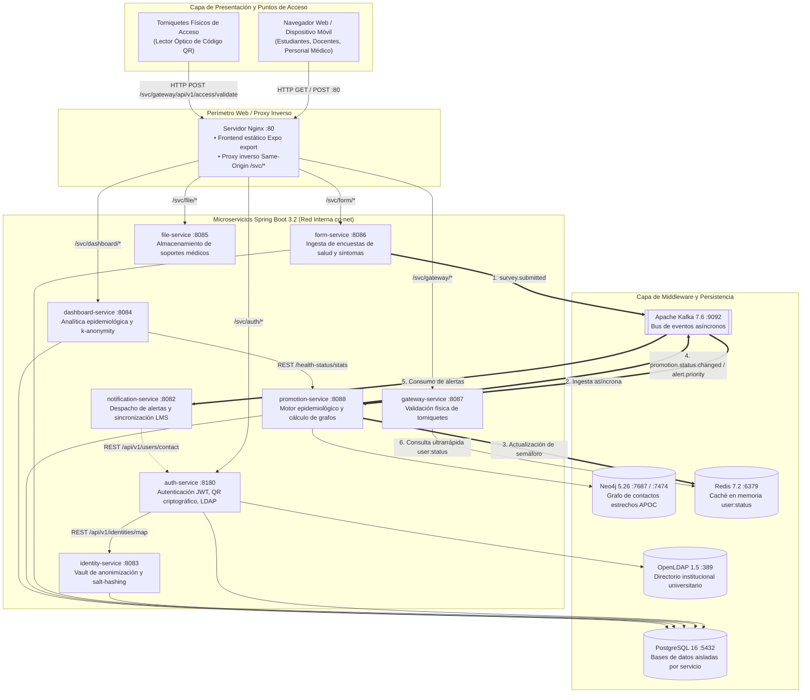
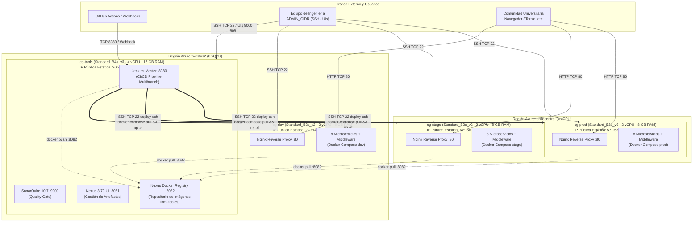
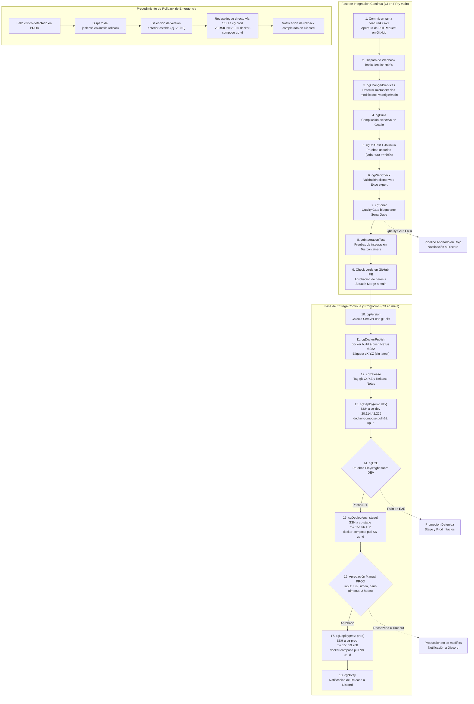

# Arquitectura Integral de CircleGuard: Aplicación, Infraestructura y Flujo de Entrega

El presente documento detalla la arquitectura completa de la plataforma **CircleGuard**, cubriendo la arquitectura lógica de software y microservicios, la topología de infraestructura multi-región desplegada en Microsoft Azure mediante scripts Bash idempotentes, y el flujo de integración y entrega continua (CI/CD) con promociones controladas y mecanismos de rollback.

---

## 1. Arquitectura de Aplicación

La arquitectura de software de CircleGuard adopta un enfoque de **microservicios orientados a eventos (*Event-Driven Microservices*)** construidos sobre **Java 21** y **Spring Boot 3.2**, con un frontend web responsivo desarrollado en **React Native / Expo** y servido a través de un servidor web y proxy inverso **Nginx**.

### Diagrama de la Arquitectura de Aplicación

### Componentes de Software y Microservicios

1. **Cliente Web y Proxy Inverso Nginx (`web`):**
   - Construido a partir de React Native / Expo mediante `npx expo export`.
   - Nginx actúa como fachada pública sirviendo los activos estáticos y actuando como proxy inverso bajo la ruta `/svc/<servicio>/*`.
   - **Beneficio Same-Origin:** Al consultar los microservicios a través del mismo dominio y puerto 80, se eliminan por completo las cabeceras y errores de CORS (*Cross-Origin Resource Sharing*) y se evita exponer los puertos backend directos a la red pública.
2. **`auth-service` (Puerto 8180):**
   - Gestiona el ciclo de vida de autenticación, validación de credenciales contra el directorio corporativo **OpenLDAP** (`circleguard.edu`), emisión de tokens JWT firmados y generación de códigos QR criptográficos.
3. **`identity-service` (Puerto 8083):**
   - Actúa como *Vault de Identidad* para anonimización de datos sensibles de salud. Disocia la identidad legal del usuario (cédula/código estudiantil) de su identificador anónimo (`anonymousId`) usando funciones resumen con salt criptográfico. Publica eventos de auditoría en Kafka (`audit.identity.accessed`).
4. **`form-service` (Puerto 8086):**
   - Recibe y valida los formularios diarios de reporte de sintomatología epidemiológica. Persiste los registros en PostgreSQL y publica el evento `survey.submitted` en Apache Kafka.
5. **`promotion-service` (Puerto 8088):**
   - Núcleo epidemiológico del sistema. Implementa una máquina de estados determinista (`Activo` $\rightarrow$ `Sospechoso` $\rightarrow$ `Probable` $\rightarrow$ `Confirmado`).
   - Evalúa el grafo de interacción en **Neo4j** para detectar círculos de contacto estrecho ante nuevos casos confirmados.
   - Sincroniza en lotes el estado de acceso de los usuarios hacia **Redis** (`user:status:<anonymousId>`).
6. **`gateway-service` (Puerto 8087):**
   - Punto de validación de acceso en los torniquetes físicos del campus. Inspecciona la firma del código QR presentado por el usuario y valida el estado epidemiológico consultando Redis en tiempo submilisegundo (< 5 ms).
7. **`notification-service` (Puerto 8082):**
   - Consume eventos Kafka (`promotion.status.changed`, `alert.priority`, `circle.fenced`) y despacha alertas por correo electrónico institucional y notificaciones push, además de interactuar con el sistema LMS institucional.
8. **`dashboard-service` (Puerto 8084):**
   - Proporciona métricas agregadas y mapas de calor epidemiológico a los directivos del campus. Implementa preservación estricta de privacidad mediante algoritmos de **$k$-anonymity ($k=5$)**.
9. **`file-service` (Puerto 8085):**
   - Servicio utilitario para el almacenamiento de soportes médicos y certificados de incapacidad.

### Flujo de Negocio: `form` $\rightarrow$ Kafka $\rightarrow$ `promotion` $\rightarrow$ Redis $\rightarrow$ `gateway`

El flujo central de CircleGuard garantiza el control epidemiológico oportuno y el bloqueo inmediato de torniquetes ante riesgos de contagio:
1. **Envío de sintomatología:** Un estudiante o colaborador ingresa al cliente web Nginx y completa su encuesta diaria en `/svc/form/api/v1/surveys`.
2. **Emisión del evento:** `form-service` almacena la respuesta en PostgreSQL y emite asíncronamente el evento `survey.submitted` en el bus de **Kafka** con el `anonymousId` y el reporte sintomático.
3. **Procesamiento de estado y cálculo de contactos:** `promotion-service` consume el evento desde Kafka, evalúa los criterios clínicos en su máquina de estados, actualiza las relaciones de contacto estrecho en el grafo de **Neo4j** y determina una transición de estado a `Sospechoso` o `Confirmado`.
4. **Actualización de la caché en memoria:** `promotion-service` actualiza inmediatamente la llave en **Redis**: `SET user:status:<anonymousId> "RESTRICTED" EX 86400`.
5. **Validación en torniquete físico:** Cuando el usuario intenta acceder al campus escaneando su código QR, el torniquete invoca `gateway-service` (`/svc/gateway/api/v1/access/validate`).
6. **Decisión instantánea:** `gateway-service` valida la firma del QR mediante `qr.secret` y consulta la clave en Redis (`GET user:status:<anonymousId>`). Al detectar el semáforo restrictivo, la puerta física permanece bloqueada y se orienta al usuario al centro médico institucional.

---

## 2. Arquitectura de Infraestructura en Microsoft Azure

La infraestructura se despliega en **Microsoft Azure** de manera automatizada e idempotente a través de scripts Bash (`infra/azure/provision.sh`, `infra/bootstrap/bootstrap-all.sh`).

### Restricciones de Cuota y Distribución Multi-Región

La suscripción académica **Azure for Students** impone un límite estricto de **6 vCPU por región**. Dado que la plataforma completa requiere 10 vCPU (4 vCPU para el servidor de herramientas y 2 vCPU para cada uno de los 3 ambientes), se diseñó una topología distribuida en dos regiones geográficas:
- **Región `westus2` (6 vCPU en total):** Aloja `cg-tools` (4 vCPU) y `cg-dev` (2 vCPU).
- **Región `chilecentral` (4 vCPU en total):** Aloja `cg-stage` (2 vCPU) y `cg-prod` (2 vCPU), brindando además menor latencia de acceso para Colombia.

### Diagrama de Infraestructura y Topología de Red

### Matriz de Servidores, IPs y Puertos (Principio de Mínimo Privilegio)

| Máquina Virtual | Región | Tamaño / Recursos | IP Pública Estática | Puertos Abiertos (NSG) | Origen Autorizado | Propósito |
|---|---|---|---|---|---|---|
| **`cg-tools`** | `westus2` | Standard_B4s_v2 (4 vCPU, 16 GB RAM) | `20.230.211.66` | • `22/TCP` • `8080/TCP` • `9000/TCP` • `8081/TCP` • `8082/TCP` | • `ADMIN_CIDR` • `Internet` (0.0.0.0/0) • `ADMIN_CIDR` • `ADMIN_CIDR` • `20.230.211.66`, `20.114.42.226`, `57.156.56.122`, `57.156.59.208`, `ADMIN_CIDR` | • Administración SSH • Webhook GitHub hacia Jenkins • Interfaz Web SonarQube • Interfaz Web Nexus • Registro Docker de Nexus |
| **`cg-dev`** | `westus2` | Standard_B2s_v2 (2 vCPU, 8 GB RAM) | `20.114.42.226` | • `22/TCP` • `80/TCP` | • `20.230.211.66/32` (Tools) y `ADMIN_CIDR` • `Internet` (0.0.0.0/0) | • Despliegue automático por SSH • Cliente web y pruebas E2E |
| **`cg-stage`** | `chilecentral` | Standard_B2s_v2 (2 vCPU, 8 GB RAM) | `57.156.56.122` | • `22/TCP` • `80/TCP` | • `20.230.211.66/32` (Tools) y `ADMIN_CIDR` • `Internet` (0.0.0.0/0) | • Despliegue automático por SSH • Pre-producción y validación |
| **`cg-prod`** | `chilecentral` | Standard_B2s_v2 (2 vCPU, 8 GB RAM) | `57.156.59.208` | • `22/TCP` • `80/TCP` | • `20.230.211.66/32` (Tools) y `ADMIN_CIDR` • `Internet` (0.0.0.0/0) | • Despliegue supervisado por SSH • Ambiente activo de producción |

### Seguridad y Aislamiento por SSH
- **Despliegues automatizados:** Jenkins en `cg-tools` se autentica en las máquinas de ambiente (`dev`, `stage`, `prod`) a través de una llave SSH dedicada (`deploy-ssh`) asociada al usuario del sistema `deploy`.
- **Restricción de origen:** Las máquinas de ambiente tienen bloqueado el puerto 22 a nivel de NSG para cualquier origen distinto a la IP pública de `cg-tools` (`20.230.211.66`) y la IP administrativa del equipo (`ADMIN_CIDR`).
- **Cero puertos de backend expuestos:** Ningún microservicio ni motor de base de datos publica puertos en la interfaz de red pública de las VMs. Todo el enrutamiento se produce a través de la red privada interna de Docker gestionada por Nginx.

---

## 3. Flujo de Entrega Continua, Promoción y Rollback

El ciclo de entrega continua implementa el principio de **Artefacto Inmutable (*Build Once, Deploy Everywhere*)**: las imágenes compiladas y empaquetadas durante el merge a `main` son promovidas sucesivamente entre ambientes sin sufrir modificaciones.

### Diagrama del Flujo de Entrega CI/CD

### Etapas Detalladas del Flujo de Entrega

1. **Apertura de Pull Request y Verificación de CI:**
   - Al abrir un PR, GitHub envía un webhook a Jenkins (`cg-tools:8080`).
   - El paso `cgChangedServices` calcula el `merge-base` con `origin/main` para determinar únicamente los microservicios modificados.
   - Si solo se modificó documentación (`docs/*`), el pipeline finaliza exitosamente en verde sin compilar servicios.
   - Para cambios de código, `cgBuild` compila los servicios, `cgUnitTest` ejecuta las pruebas con JaCoCo (exigiendo $\ge 60\%$ de cobertura de líneas en servicios núcleo), y `cgSonar` evalúa el Quality Gate de SonarQube con carácter bloqueante (`abortPipeline: true`).
   - `cgIntegrationTest` ejecuta pruebas contra contenedores reales de PostgreSQL, Redis, Kafka y Neo4j usando **Testcontainers**.
2. **Squash Merge y Determinación de Versión:**
   - Aprobado el PR por un par y con el status check de Jenkins en verde, se realiza un **Squash and Merge**.
   - En la ejecución sobre `main`, el paso `cgVersion` analiza los commits acumulados mediante `git-cliff`. Si el commit no contiene tipos liberables (`feat`, `fix`, `!`), el pipeline termina normalmente sin generar releases vacíos.
3. **Publicación Inmutable en Nexus (`cgDockerPublish`):**
   - Se construyen las imágenes de los 8 microservicios y del cliente web, etiquetándolas con la versión semántica exacta calculada (por ejemplo, `circleguard/promotion-service:v1.1.0`).
   - Las imágenes se publican en el registro Docker privado de Nexus (`20.230.211.66:8082`). **Se prohíbe taxativamente el uso de la etiqueta `latest`**.
   - Se crea el tag Git inmutable y se agregan las notas de versión al repositorio (`cgRelease`).
4. **Despliegue a DEV y Validación E2E (`cgDeploy` y `cgE2E`):**
   - Jenkins se conecta por SSH a `cg-dev` (`20.114.42.226`) y ejecuta el despliegue con las imágenes recién publicadas.
   - El pipeline comprueba las sondas `/actuator/health` de cada contenedor.
   - Inmediatamente se ejecuta la suite de pruebas End-to-End con **Playwright** sobre la interfaz web de `dev`. Si alguna prueba de autenticación, encuesta o validación de acceso falla, **el pipeline se detiene de forma tajante**, impidiendo la propagación a staging.
5. **Promoción a STAGE y Compuerta Humana:**
   - Superados los E2E, se promueve la versión al ambiente `stage` (`57.156.56.122`) de forma automática para pruebas de aceptación.
   - El pipeline entra en suspensión en el paso interactivo `input` (*Aprobación PROD*). Solo los usuarios autorizados (`luis`, `simon`, `dario`) pueden autorizar el paso.
   - Para no agotar los ejecutores de Jenkins durante la ventana de decisión (timeout de 2 horas), la etapa utiliza `agent none` y `beforeAgent true`.
6. **Despliegue a PROD y Notificación:**
   - Otorgada la aprobación formal, Jenkins despliega la misma versión inmutable vía SSH en `cg-prod` (`57.156.59.208`).
   - Se despacha una notificación de éxito al canal `#circleguard-ci` en Discord identificando la versión liberada, los componentes actualizados y el usuario que aprobó el despliegue.
7. **Estrategia y Demostración de Rollback:**
   - Si una versión en producción presenta una regresión no detectada, se activa el pipeline especializado `jenkins/Jenkinsfile.rollback`.
   - El operador especifica la versión previa conocida y estable (p. ej. `v1.0.0`).
   - El job no compila ni genera imágenes nuevas: se conecta vía SSH a `cg-prod` y actualiza la variable `VERSION` en el archivo de entorno, ejecutando `docker-compose pull && docker-compose up -d`.
   - El sistema retorna a un estado operativo normal en menos de 60 segundos, cumpliendo la política de alta disponibilidad del campus.
