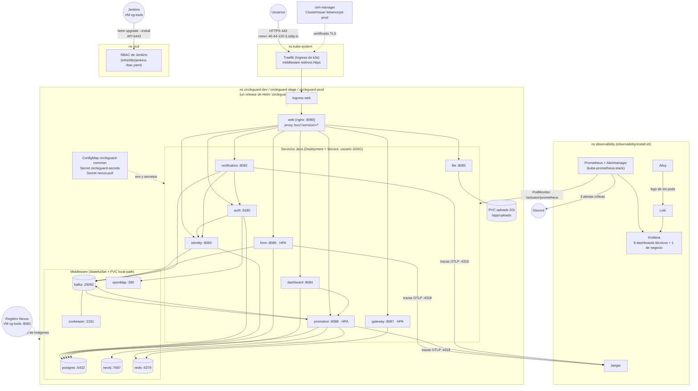

# Arquitectura en Kubernetes (Parte 2)

Diagrama de lo que corre dentro del clúster k3s `cg-k3s`. Fuentes: el chart
[`deploy/helm/circleguard`](../../deploy/helm/circleguard) (`values.yaml`,
`templates/`), [`observability/`](../../observability) e
[`infra/k8s/`](../../infra/k8s). La infraestructura de Azure que lo sostiene está en
[`terraform.md`](terraform.md).

## Cómo leerlo (con evidencia)

| Elemento | Evidencia en el repo |
|---|---|
| Un namespace por ambiente y `observability`, `cicd` | `namespaces` en `infra/terraform/envs/shared/main.tf`; README de Terraform |
| Solo el web se publica por Ingress (Traefik); los backends son internos | comentario en `values.yaml` (`ingress`), `templates/web.yaml` |
| Nginx enruta `/svc/<servicio>/` a cada backend y bloquea `actuator` | `templates/web.yaml` (ConfigMap `web-nginx`) |
| 8 servicios Java con puertos, dependencias (`waitFor`) y secretos | `services:` en `values.yaml` |
| HPA en gateway, form y promotion | `hpa: true` en `values.yaml` |
| Middleware con PVC | `middleware:` en `values.yaml` |
| `file` monta un PVC en `/app/uploads` | `services.file` en `values.yaml` |
| Trazas desde form, promotion y notification | `tracing: true` y `tracing.endpoint` en `values.yaml` |
| Prometheus, Grafana, Alertmanager, Jaeger, Loki y Alloy | `observability/README.md` |
| Imágenes desde Nexus con `nexus-pull` | `global` en `values.yaml` |

## Notas

- Las flechas entre servicios salen de las URLs y de `waitFor` de `values.yaml`.
  Las de `form → kafka → promotion` corresponden al flujo por eventos descrito en
  [`arquitectura.md`](arquitectura.md); la dirección del consumo no se verificó de
  nuevo en el código para este diagrama (**pendiente de evidencia**).
- Cómo se abre Grafana desde fuera: el README de observabilidad indica
  `port-forward`; no hay un Ingress de Grafana en el chart (**pendiente de evidencia**
  si el equipo lo publicó aparte).
- Imagen PNG exportada: **pendiente** (no hay `mmdc` en este entorno). GitHub
  renderiza el Mermaid directamente.
