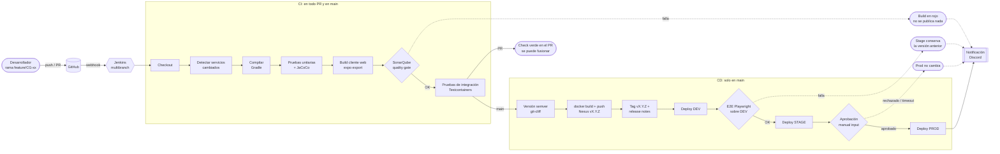

# Pipeline CI/CD de CircleGuard

El pipeline está en [`Jenkinsfile`](../../Jenkinsfile) y sus etapas reutilizables en la Shared Library [`jenkins/vars`](../../jenkins/vars). La configuración de Jenkins está en [`jenkins/README.md`](../../jenkins/README.md).

## Vista general

## Etapas

| # | Etapa | Dónde corre | Puerta | Paso de la librería |
|---|---|---|---|---|
| 1 | Checkout | PR y main | | `checkout scm` |
| 2 | Detectar cambios | PR y main | | `cgChangedServices` |
| 3 | Compilar | PR y main | Falla si no compila | `cgBuild` |
| 4 | Pruebas unitarias + JaCoCo | PR y main | Falla si una prueba falla o si la cobertura de líneas de un servicio núcleo es < 60 % (`jacocoTestCoverageVerification`) | `cgUnitTest` |
| 5 | Build cliente web | PR y main, si cambió `mobile/` | Falla si `expo export` falla | `cgWebCheck` |
| 6 | SonarQube + quality gate | PR y main | **Bloqueante** (`abortPipeline: true`) | `cgSonar` |
| 7 | Pruebas de integración | PR y main | Falla si una prueba falla | `cgIntegrationTest` |
| 8 | Versión | main | Si no hay `feat`/`fix`/`!`, termina aquí (no hay release) | `cgVersion` |
| 9 | Empaquetar y publicar | main | | `cgDockerPublish` |
| 10 | Tag + release notes | main | | `cgRelease` |
| 11 | Deploy DEV | main | Falla si un servicio no queda *healthy* | `cgDeploy` |
| 12 | E2E sobre DEV | main | **Bloqueante**: si falla, no llega a stage | `cgE2E` |
| 13 | Deploy STAGE | main | Falla si un servicio no queda *healthy* | `cgDeploy` |
| 14 | Aprobación PROD | main | **Manual** (`input`, 2 h de timeout, solo `CG_PROD_APPROVERS`) | `input` |
| 15 | Deploy PROD | main | Falla si un servicio no queda *healthy* | `cgDeploy` |
| — | Notificación | siempre al final | Fallo, inestable, abortado o release a prod | `cgNotify` |

## Ambientes

| Ambiente | Cómo llega una versión |
|---|---|
| dev | Automático en cada build de `main` que genera una versión nueva (el build de `main` se lanza a mano: Nexus no permite republicar una versión) |
| stage | Automático, si pasan los E2E sobre dev |
| prod | Solo con aprobación manual en Jenkins |

Los tres ambientes reciben **la misma imagen con la misma versión** (*build once, deploy many*): lo que se probó en dev y stage es exactamente lo que llega a prod. Entre ambientes solo cambia la configuración (`.env` de cada servidor).

## Decisiones de diseño

**Ejecución selectiva solo para validar.** En un PR se compilan, prueban y analizan solo los servicios que cambiaron, comparando contra la rama destino. En `main` se compara contra el último build exitoso. Un cambio global (Gradle raíz, `Jenkinsfile`, `jenkins/`) o el parámetro `BUILD_ALL` construye todo.

Cómo decide `cgChangedServices` qué construir:

| Situación | Contra qué compara | Qué se construye |
|---|---|---|
| PR | `merge-base` entre el PR y su rama destino. El clon de un PR solo trae la rama del PR, así que el pipeline descarga `origin/<destino>` con la credencial de GitHub antes de comparar | Solo los servicios con archivos en `services/<servicio>/` y el cliente web si cambió `mobile/` |
| `main` | Último build exitoso de `main` | Igual que en un PR |
| Primer build o sin referencia | No hay con qué comparar | Todo, por seguridad |
| Cambio global o `BUILD_ALL` | No aplica | Todo |
| Solo documentación (`docs/`, `*.md`) | Igual que en un PR | Nada: las etapas de compilación, pruebas y Sonar se saltan y el build queda en verde |

**En `main` se publican todas las imágenes.** Si solo cambió `auth`, igual se publican los 8 servicios y el cliente con la nueva versión, porque el compose de cada ambiente usa una sola `VERSION` para todos los servicios. Si solo se publicara `auth:v1.1.0`, la imagen `identity:v1.1.0` no existiría y el despliegue fallaría. Una versión es un release completo del sistema. La alternativa (una variable de versión por servicio) es más fina, pero mucho más difícil de operar y de revertir.

**Sin cambios publicables no hay release.** Un merge con solo `docs`, `chore`, `ci` o `test` pasa la CI, pero no genera versión, imágenes ni despliegue.

**El tag se crea después de publicar.** Si la publicación falla, no queda un tag que apunte a imágenes inexistentes.

**La aprobación no ocupa un ejecutor.** El pipeline no tiene agente global (`agent none`) y la etapa de aprobación no pide agente, así que mientras una persona decide ningún ejecutor queda bloqueado.

**Rollback = redesplegar una versión anterior** con el job [`jenkins/Jenkinsfile.rollback`](../../jenkins/Jenkinsfile.rollback), sin reconstruir nada. Flyway solo avanza: el rollback no revierte el esquema de la base de datos, por eso las migraciones deben ser compatibles hacia atrás (*expand/contract*).

Versión UML (diagrama de actividad): [`uml/pipeline-actividad.png`](uml/pipeline-actividad.png) y [`uml/rollback-actividad.png`](uml/rollback-actividad.png).
