# Pipeline CI/CD de CircleGuard

El pipeline está en [`Jenkinsfile`](../../Jenkinsfile) y sus etapas reutilizables en la Shared Library [`jenkins/vars`](../../jenkins/vars). La configuración de Jenkins está en [`jenkins/README.md`](../../jenkins/README.md).

## Vista general

```mermaid
flowchart LR
    dev([Desarrollador<br/>rama feature/CG-xx]) -- push / PR --> gh[(GitHub)]
    gh -- webhook --> jk{{Jenkins<br/>multibranch}}

    subgraph CI["CI: en todo PR y en main"]
        direction LR
        co[Checkout] --> chg[Detectar servicios<br/>cambiados]
        chg --> build[Compilar<br/>Gradle]
        build --> unit[Pruebas unitarias<br/>+ JaCoCo]
        unit --> web[Build cliente web<br/>expo export]
        web --> sonar{SonarQube<br/>quality gate}
        sonar -- OK --> it[Pruebas de integración<br/>Testcontainers]
        it --> tiac{Trivy IaC +<br/>Terraform validate}
    end

    jk --> co
    sonar -. falla .-> stop1([Build en rojo<br/>no se publica nada])

    subgraph CD["CD: solo en main"]
        direction LR
        tfp[Terraform plan<br/>dev, stage, prod] --> ver[Versión semver<br/>git-cliff]
        ver --> pub{docker build +<br/>Trivy + push<br/>vX.Y.Z-SNAPSHOT.N}
        pub --> ddev[Helm DEV]
        ddev --> e2e{E2E Playwright<br/>sobre DEV}
        e2e -- OK --> zap{OWASP ZAP<br/>sobre DEV}
        zap -- OK --> dstage[Helm STAGE]
        dstage --> appr{Aprobación<br/>manual input}
        appr -- aprobado --> prom[Promover SNAPSHOT<br/>a vX.Y.Z, mismo digest]
        prom --> tag[Tag + release notes]
        tag --> dprod[Helm PROD]
    end

    tiac -- PR --> prok([Check verde en el PR<br/>se puede fusionar])
    tiac -- main --> tfp
    pub -. CRITICAL .-> stop4([Trivy bloquea:<br/>no se publica])
    e2e & zap -. falla .-> stop2([Stage conserva<br/>la versión anterior])
    appr -. rechazado / timeout .-> stop3([Prod no cambia<br/>y no hay tag vX.Y.Z])

    stop1 & stop2 & stop3 & stop4 -.-> notif[[Notificación<br/>Discord]]
    dprod --> notif
```

## Etapas

| # | Etapa | Dónde corre | Puerta | Paso de la librería |
|---|---|---|---|---|
| 1 | Checkout | PR y main | | `checkout scm` |
| 2 | Detectar cambios | PR y main | | `cgChangedServices` |
| 3 | Compilar | PR y main | Falla si no compila | `cgBuild` |
| 4 | Pruebas unitarias + JaCoCo | PR y main | Falla si una prueba falla o si la cobertura de líneas de un servicio núcleo es < 60 % (`jacocoTestCoverageVerification`) | `cgUnitTest` |
| 5 | Build cliente web | PR y main, si cambió `mobile/` | Falla si `expo export` falla | `cgWebCheck` |
| 6 | SonarQube + quality gate | PR y main | **Bloqueante** (`abortPipeline: true`) | `cgSonar` |
| 7 | Pruebas de integración | PR y main | Falla si una prueba falla | `cgIntegrationTest` |
| 8 | Trivy IaC | PR y main, si hay `infra/terraform` o `deploy/helm` | **Bloqueante** con hallazgos `CRITICAL` | `cgTrivy.scanConfig` |
| 9 | Terraform validate | PR y main, si hay Terraform | Falla si `fmt` o `validate` fallan (sin credenciales de la nube) | `cgTerraform.validate` |
| 10 | Terraform plan | main | Plan de dev, stage y prod como artefacto (`tfplan-<env>.txt`) | `cgTerraform.plan` |
| 11 | Terraform apply DEV | main, si el plan de dev tiene cambios | Aplica el plan guardado | `cgTerraform.apply` |
| 12 | Versión | main | Si no hay `feat`/`fix`/`!`, no hay release | `cgVersion` |
| 13 | Empaquetar, escanear y publicar | main | **Trivy bloqueante**: una imagen con `CRITICAL` corregible no se publica. Se publica `vX.Y.Z-SNAPSHOT.N` | `cgDockerPublish`, `cgTrivy` |
| 14 | Deploy DEV | main | `helm upgrade --atomic --wait`: si un pod no queda listo, Helm revierte | `cgDeploy` |
| 15 | E2E sobre DEV | main | **Bloqueante**: si falla, no llega a stage | `cgE2E` |
| 16 | OWASP ZAP sobre DEV | main | **Bloqueante** con alertas `FAIL` de `tests/security-zap/zap-baseline.conf` | `cgZap` |
| 17 | Terraform apply STAGE | main, si el plan de stage tiene cambios | Aplica el plan guardado | `cgTerraform.apply` |
| 18 | Deploy STAGE | main | Igual que dev, misma SNAPSHOT | `cgDeploy` |
| 19 | Aprobación PROD | main, si hay release o cambios de Terraform en prod | **Manual** (`input`, 2 h de timeout, solo `CG_PROD_APPROVERS`) | `input` |
| 20 | Terraform apply PROD | main, si el plan de prod tiene cambios | Aplica exactamente el plan aprobado | `cgTerraform.apply` |
| 21 | Promover a release | main | Copia la SNAPSHOT como `vX.Y.Z` y **compara digests** | `cgPromote` |
| 22 | Tag + release notes | main | Solo después de aprobar y promover | `cgRelease` |
| 23 | Deploy PROD | main | Igual que dev, versión `vX.Y.Z` | `cgDeploy` |
| — | Notificación | siempre al final | Fallo, inestable, abortado o release a prod | `cgNotify` |

## Ambientes

| Ambiente | Cómo llega una versión |
|---|---|
| dev (`circleguard-dev`) | Automático en cada build de `main` que genera una versión nueva, como `vX.Y.Z-SNAPSHOT.N` (el build de `main` se lanza a mano) |
| stage (`circleguard-stage`) | Automático, si pasan los E2E y ZAP sobre dev; misma SNAPSHOT |
| prod (`circleguard-prod`) | Solo con aprobación manual: la SNAPSHOT se promueve a `vX.Y.Z` y se despliega |

Los tres ambientes reciben **la misma imagen** (*build once, deploy many*): la SNAPSHOT que se probó en dev y stage se re-etiqueta como `vX.Y.Z` sin reconstruirla, y el pipeline verifica que el digest sea idéntico. Entre ambientes solo cambia la configuración (`values-<env>.yaml` del chart). El modo de despliegue lo elige la variable `CG_DEPLOY_TARGET`: `helm` (Kubernetes, por defecto) o `compose` (SSH a las VMs de la Parte 1, como respaldo).

## Decisiones de diseño

**Ejecución selectiva solo para validar.** En un PR se compilan, prueban y analizan solo los servicios que cambiaron, comparando contra la rama destino. En `main` se compara contra el último build exitoso. Un cambio global (Gradle raíz, `Jenkinsfile`, `jenkins/`) o el parámetro `BUILD_ALL` construye todo.

Cómo decide `cgChangedServices` qué construir:

| Situación | Contra qué compara | Qué se construye |
|---|---|---|
| PR | `merge-base` entre el PR y su rama destino. El clon de un PR solo trae la rama del PR, así que el pipeline descarga `origin/<destino>` con la credencial de GitHub antes de comparar | Solo los servicios con archivos en `services/<servicio>/` y el cliente web si cambió `mobile/` |
| `main` | Último build exitoso de `main` | Igual que en un PR |
| Primer build o sin referencia | No hay con qué comparar | Todo, por seguridad |
| Cambio global o `BUILD_ALL` | No aplica | Todo |
| Solo documentación (`docs/`, `*.md`) | Igual que en un PR | Nada: las etapas de compilación, pruebas y Sonar se saltan y el build queda en verde |

**En `main` se publican todas las imágenes.** Si solo cambió `auth`, igual se publican los 8 servicios y el cliente con la nueva versión, porque el compose de cada ambiente usa una sola `VERSION` para todos los servicios. Si solo se publicara `auth:v1.1.0`, la imagen `identity:v1.1.0` no existiría y el despliegue fallaría. Una versión es un release completo del sistema. La alternativa (una variable de versión por servicio) es más fina, pero mucho más difícil de operar y de revertir.

**Sin cambios publicables no hay release.** Un merge con solo `docs`, `chore`, `ci` o `test` pasa la CI, pero no genera versión, imágenes ni despliegue.

**SNAPSHOT primero, release solo con aprobación (CG-116).** dev y stage prueban `vX.Y.Z-SNAPSHOT.N`. El release `vX.Y.Z`, el tag y el GitHub Release se crean solo después de aprobar producción y promover la imagen. Si alguien rechaza, no queda ningún `vX.Y.Z`: la versión sigue disponible para el siguiente intento.

**Seguridad antes de publicar (CG-90, CG-92).** Trivy escanea cada imagen antes del push y la infraestructura como código en cada PR; bloquea con `CRITICAL` que tenga arreglo. Las excepciones aceptadas van en `.trivyignore` con motivo, responsable y fecha de revisión. ZAP baseline revisa el web de dev después de los E2E; solo las reglas `FAIL` bloquean.

**Terraform: lo que se aprueba es lo que se aplica (CG-89).** El plan se guarda y `apply` usa ese archivo, no vuelve a planear. El plan de prod se hace antes de la aprobación para que quien aprueba lo vea en los artefactos.

**La aprobación no ocupa un ejecutor.** El pipeline no tiene agente global (`agent none`) y la etapa de aprobación no pide agente, así que mientras una persona decide ningún ejecutor queda bloqueado.

**Rollback = redesplegar un release anterior** con el job [`jenkins/Jenkinsfile.rollback`](../../jenkins/Jenkinsfile.rollback), sin reconstruir nada. En Kubernetes es un `helm upgrade --atomic` con la versión anterior (CG-91). Flyway solo avanza: el rollback no revierte el esquema de la base de datos, por eso las migraciones deben ser compatibles hacia atrás (*expand/contract*).

Versión UML (diagrama de actividad): [`uml/pipeline-actividad.png`](uml/pipeline-actividad.png) y [`uml/rollback-actividad.png`](uml/rollback-actividad.png).
