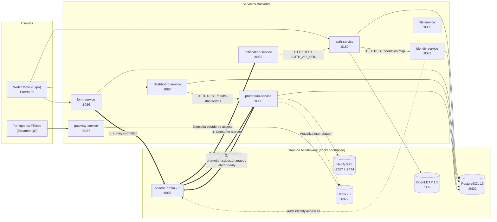

# Mapa de servicios CircleGuard

CircleGuard es una plataforma integral para la monitorización epidemiológica, control de acceso físico seguro mediante QR criptográfico y gestión de alertas en campus universitarios. Está construida sobre una arquitectura de microservicios con Java 21 y Spring Boot 3.2, un cliente web responsivo en React Native / Expo, y una infraestructura middleware compuesta por PostgreSQL, Neo4j, Apache Kafka, Redis y OpenLDAP.

## Servicios del ecosistema

| Servicio (docker-compose) | Subproyecto Gradle | Puerto | Base de datos | Middleware | Llama a otros servicios | Notas y responsabilidades |
|---|---|---|---|---|---|---|
| `auth-service` | `services/circleguard-auth-service` | 8180 | PostgreSQL (`circleguard_auth`) | PostgreSQL, OpenLDAP | `identity-service` (HTTP REST `/api/v1/identities/map`) | Emisión y validación de JWT, generación de QR firmados, autenticación institucional vía LDAP. |
| `identity-service` | `services/circleguard-identity-service` | 8083 | PostgreSQL (`circleguard_identity`) | PostgreSQL, Kafka | Ninguno (autónomo) | Vault de identidad: desasocia identidades reales de UUIDs anónimos mediante funciones hash con salt; audita accesos en Kafka (`audit.identity.accessed`). |
| `promotion-service` | `services/circleguard-promotion-service` | 8088 | PostgreSQL (`circleguard_promotion`) y Neo4j | PostgreSQL, Neo4j, Kafka, Redis | Ninguno directo (event-driven) | Motor epidemiológico central: máquina de estados (Activo → Sospechoso → Probable → Confirmado), reevaluación de grafos de cercanía en Neo4j, actualización en lotes a Redis (`user:status:*`). Consume `survey.submitted` y `certificate.validated`; publica `promotion.status.changed`, `alert.priority`, `circle.fenced` y `proximity.detected`. |
| `notification-service` | `services/circleguard-notification-service` | 8082 | Ninguna (stateless) | Kafka, Servidor SMTP/Mail | `auth-service` (HTTP REST `${AUTH_API_URL}`) | Consumidor de eventos Kafka (`promotion.status.changed`, `alert.priority`, `circle.fenced`). Envía notificaciones por email/push y sincroniza asistencia remota (LMS). |
| `form-service` | `services/circleguard-form-service` | 8086 | PostgreSQL (`circleguard_form`) | PostgreSQL, Kafka | Ninguno directo | Ingesta de formularios de sintomatología diaria y validación de soportes médicos. Publica eventos `survey.submitted` y `certificate.validated` a Kafka. |
| `file-service` | `services/circleguard-file-service` | 8085 | Ninguna (almacenamiento local `uploads/` / S3) | Ninguno en dev (S3/MinIO configurable) | Ninguno directo | Almacenamiento seguro de archivos adjuntos (certificados médicos, incapacidades). |
| `gateway-service` | `services/circleguard-gateway-service` | 8087 | Redis (en memoria) | Redis | Ninguno directo (validación local) | Validación criptográfica de tokens QR (`qr.secret`) en torniquetes de acceso y consulta de semáforo de riesgo en Redis (`user:status:<anonymousId>`). |
| `dashboard-service` | `services/circleguard-dashboard-service` | 8084 | PostgreSQL (`circleguard_dashboard`) | PostgreSQL | `promotion-service` (HTTP REST `${circleguard.promotion-service.url:http://localhost:8088}`) | Analítica epidemiológica agregada; implementa k-anonymity (k=5) para preservar la privacidad de datos de salud. |
| `web` | `mobile/` | 80 | Ninguna (SecureStore local) | Ninguno | Todos los servicios vía Gateway / REST | Frontend web y móvil en React Native / Expo para estudiantes, personal médico, docentes y guardias de seguridad. |

## Middleware e infraestructura

Datos leídos de `docker-compose.dev.yml` e `init-db.sql`:

| Componente | Servicio docker-compose | Imagen y versión | Puertos expuestos | Usado por | Rol en la arquitectura |
|---|---|---|---|---|---|
| PostgreSQL | `postgres` | `postgres:16` | 5432:5432 | `auth-service`, `identity-service`, `promotion-service`, `form-service`, `dashboard-service` | Almacenamiento relacional transaccional. `init-db.sql` crea bases de datos aisladas: `circleguard_auth`, `circleguard_identity`, `circleguard_promotion`, `circleguard_dashboard`, `circleguard_form`. |
| Neo4j | `neo4j` | `neo4j:5.26` | 7474:7474 (HTTP) 7687:7687 (Bolt) | `promotion-service` | Base de datos de grafos con plugin APOC. Modela las relaciones de contacto, cercanía entre usuarios y círculos de interacción para trazabilidad de contagios. |
| Apache Kafka | `kafka` | `confluentinc/cp-kafka:7.6.0` | 9092:9092 | `form-service`, `promotion-service`, `notification-service`, `identity-service` | Bus de eventos asíncrono desacoplado. Gestiona tópicos de encuestas, cambios de estado epidemiológico, cercanía y auditoría. |
| Zookeeper | `zookeeper` | `confluentinc/cp-zookeeper:7.6.0` | 2181 (interno) | `kafka` | Coordinación de clúster y metadatos para Kafka. |
| Redis | `redis` | `redis:7.2` | 6379:6379 | `gateway-service`, `promotion-service` | Base de datos en memoria ultrarrápida. Almacena el estado de acceso de usuarios (`user:status:<id>`) actualizado en lotes por promotion-service y leído en milisegundos por gateway-service. |
| OpenLDAP | `openldap` | `osixia/openldap:1.5.0` | 389:389 (LDAP) 636:636 (LDAPS) | `auth-service` | Servidor de directorio institucional (`circleguard.edu`) para autenticación corporativa y validación de credenciales. |

## Propiedades de configuración y variables de entorno por ambiente

Las aplicaciones de Spring Boot aplican *relaxed binding*, lo que permite sobreescribir cualquier propiedad de configuración mediante variables de entorno en mayúsculas y guiones bajos. **En ningún caso se deben versionar valores de secretos o credenciales reales en el repositorio.**

| Categoría | Propiedad Spring (`application.yml`) | Variable de entorno (*relaxed binding*) | Servicios que la utilizan | Propósito |
|---|---|---|---|---|
| **Base de datos** | `spring.datasource.url` | `SPRING_DATASOURCE_URL` | `auth`, `identity`, `promotion`, `form`, `dashboard` | URL JDBC de conexión al servidor PostgreSQL y base de datos específica. |
| **Base de datos** | `spring.datasource.username` | `SPRING_DATASOURCE_USERNAME` | `auth`, `identity`, `promotion`, `form`, `dashboard` | Usuario de conexión a la base de datos PostgreSQL. |
| **Base de datos** | `spring.datasource.password` | `SPRING_DATASOURCE_PASSWORD` | `auth`, `identity`, `promotion`, `form`, `dashboard` | Contraseña del usuario de la base de datos (secreto). |
| **Base de datos** | `spring.datasource.driver-class-name` | `SPRING_DATASOURCE_DRIVER_CLASS_NAME` | `auth`, `identity`, `promotion`, `form`, `dashboard` | Nombre de la clase del driver JDBC (`org.postgresql.Driver`). |
| **JPA / Hibernate** | `spring.jpa.hibernate.ddl-auto` | `SPRING_JPA_HIBERNATE_DDL_AUTO` | `auth`, `identity`, `promotion`, `form`, `dashboard` | Estrategia DDL de Hibernate (`update`, `validate`, `none`). |
| **Neo4j** | `spring.neo4j.uri` | `SPRING_NEO4J_URI` | `promotion-service` | URI de conexión Bolt (`bolt://localhost:7687`). |
| **Neo4j** | `spring.neo4j.authentication.username` | `SPRING_NEO4J_AUTHENTICATION_USERNAME` | `promotion-service` | Usuario de autenticación en Neo4j. |
| **Neo4j** | `spring.neo4j.authentication.password` | `SPRING_NEO4J_AUTHENTICATION_PASSWORD` | `promotion-service` | Contraseña de autenticación en Neo4j (secreto). |
| **Kafka** | `spring.kafka.bootstrap-servers` | `SPRING_KAFKA_BOOTSTRAP_SERVERS` | `form`, `promotion`, `notification`, `identity` | Lista de brokers Kafka (`host:port`). |
| **Kafka** | `spring.kafka.consumer.group-id` | `SPRING_KAFKA_CONSUMER_GROUP_ID` | `promotion`, `notification` | Identificador del grupo consumidor de mensajes. |
| **Kafka** | `spring.kafka.consumer.auto-offset-reset` | `SPRING_KAFKA_CONSUMER_AUTO_OFFSET_RESET` | `promotion`, `notification` | Política de desplazamiento inicial de offset (`earliest`, `latest`). |
| **Redis** | `spring.data.redis.host` | `SPRING_DATA_REDIS_HOST` | `gateway`, `promotion` | Host del servidor Redis en memoria. |
| **Redis** | `spring.data.redis.port` | `SPRING_DATA_REDIS_PORT` | `gateway`, `promotion` | Puerto del servidor Redis (`6379`). |
| **OpenLDAP** | `spring.ldap.urls` | `SPRING_LDAP_URLS` | `auth-service` | URLs de conexión al servidor de directorio LDAP (`ldap://localhost:389`). |
| **OpenLDAP** | `spring.ldap.base` | `SPRING_LDAP_BASE` | `auth-service` | Base DN para búsquedas en el directorio (`dc=circleguard,dc=edu`). |
| **OpenLDAP** | `spring.ldap.username` | `SPRING_LDAP_USERNAME` | `auth-service` | Bind DN del administrador de LDAP (`cn=admin,dc=circleguard,dc=edu`). |
| **OpenLDAP** | `spring.ldap.password` | `SPRING_LDAP_PASSWORD` | `auth-service` | Contraseña del bind DN de LDAP (secreto). |
| **Criptografía / Tokens** | `jwt.secret` | `JWT_SECRET` | `auth`, `identity`, `promotion`, `notification`, `gateway` | Clave secreta HMAC para firma y verificación de tokens JWT (secreto). |
| **Criptografía / Tokens** | `jwt.expiration` | `JWT_EXPIRATION` | `auth`, `promotion`, `notification`, `gateway` | Tiempo de vida en milisegundos de los tokens JWT. |
| **Criptografía / QR** | `qr.secret` | `QR_SECRET` | `auth`, `notification`, `gateway` | Clave secreta para generación y validación criptográfica de códigos QR (secreto). |
| **Criptografía / QR** | `qr.expiration` | `QR_EXPIRATION` | `auth`, `notification`, `gateway` | Tiempo de expiración en segundos de los códigos QR. |
| **Vault / Anonimización**| `vault.secret` | `VAULT_SECRET` | `identity-service` | Clave de cifrado simétrico para el almacén de identidades (secreto). |
| **Vault / Anonimización**| `vault.salt` | `VAULT_SALT` | `identity-service` | Salt para funciones de derivación y hash de identidad (secreto). |
| **Vault / Anonimización**| `vault.hash-salt` | `VAULT_HASH_SALT` | `identity-service` | Salt específico para cálculo de identificadores anónimos. |
| **Integración HTTP** | `auth.api.url` | `AUTH_API_URL` | `notification-service` | URL del servicio de autenticación (`http://localhost:8180`). |
| **Integración HTTP** | `circleguard.promotion-service.url` | `CIRCLEGUARD_PROMOTION_SERVICE_URL` | `dashboard-service` | URL del servicio de promoción (`http://localhost:8088`). |
| **Correo / Alertas** | `spring.mail.host` | `SPRING_MAIL_HOST` | `notification-service` | Servidor SMTP para despacho de alertas por correo electrónico. |
| **Correo / Alertas** | `spring.mail.port` | `SPRING_MAIL_PORT` | `notification-service` | Puerto del servidor SMTP (`25`). |
| **Servidor Web** | `server.port` | `SERVER_PORT` | Todos los servicios | Puerto TCP en el que escucha el servidor Tomcat embebido. |

## Diagrama de arquitectura y flujo de eventos

