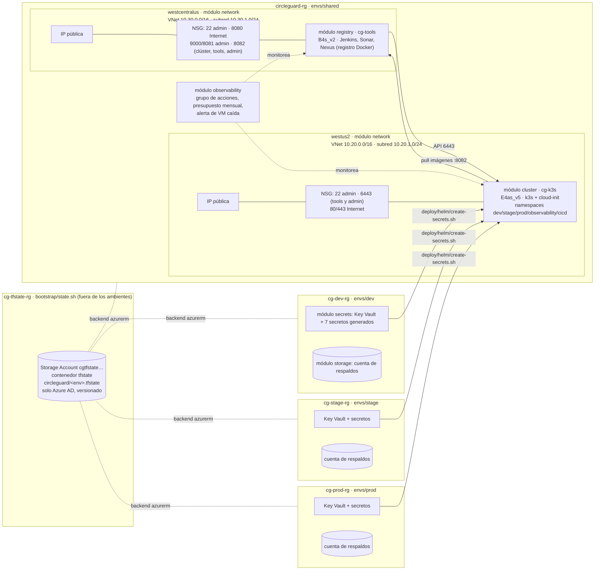

# Infraestructura de Terraform (Parte 2)

Fuente: [`infra/terraform`](../../infra/terraform) (`envs/shared`, `envs/{dev,stage,prod}`,
`modules/*`, `bootstrap/state.sh`). Vista dentro del clúster en
[`kubernetes.md`](kubernetes.md).

## Qué aplica cada raíz

| Raíz | Módulos que llama | La aplica |
|---|---|---|
| `envs/shared` | `network` (×2), `cluster`, `registry`, `observability` | Administrador (una vez) |
| `envs/dev`, `stage`, `prod` | `secrets`, `storage` | Jenkins: plan en PR, apply en `main` (prod con aprobación) |

## Correspondencia con el código

| Elemento del diagrama | Dónde |
|---|---|
| Dos VNet, subredes, NSG, IP pública | `modules/network/main.tf`; rangos y reglas en `envs/shared/main.tf` |
| VM del clúster k3s | `modules/cluster` (`cloud-init.yaml.tftpl`) |
| VM de herramientas (módulo llamado `registry`) | `modules/registry/main.tf` |
| Presupuesto y alerta de VM caída | `modules/observability/main.tf` |
| Key Vault y secretos | `modules/secrets/main.tf` |
| Respaldos | `modules/storage/main.tf` |
| Backend remoto | `envs/*/backend.tf`, `bootstrap/state.sh` |

## Notas

- Regiones, tamaños de VM y la cuenta del estado salen del README de Terraform y de
  `envs/shared`; los nombres exactos de `cg-<env>-rg` provienen del README
  (`cg-<env>-rg`) y no se revisaron en `envs/<env>/main.tf` línea por línea
  (**pendiente de evidencia**).
- El "registro" es Nexus (puerto 8082) en la VM `cg-tools`; no hay Azure Container
  Registry en el Terraform.
- Imagen PNG exportada: **pendiente** (no hay `mmdc` en este entorno).
