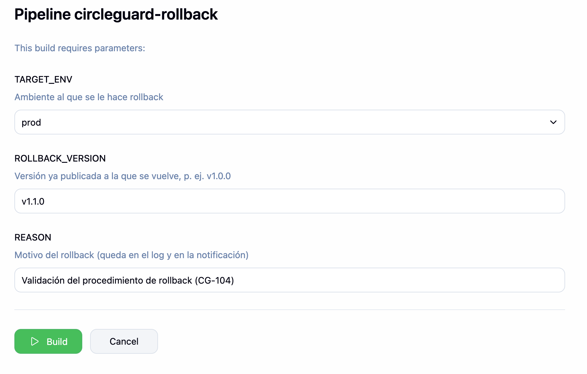
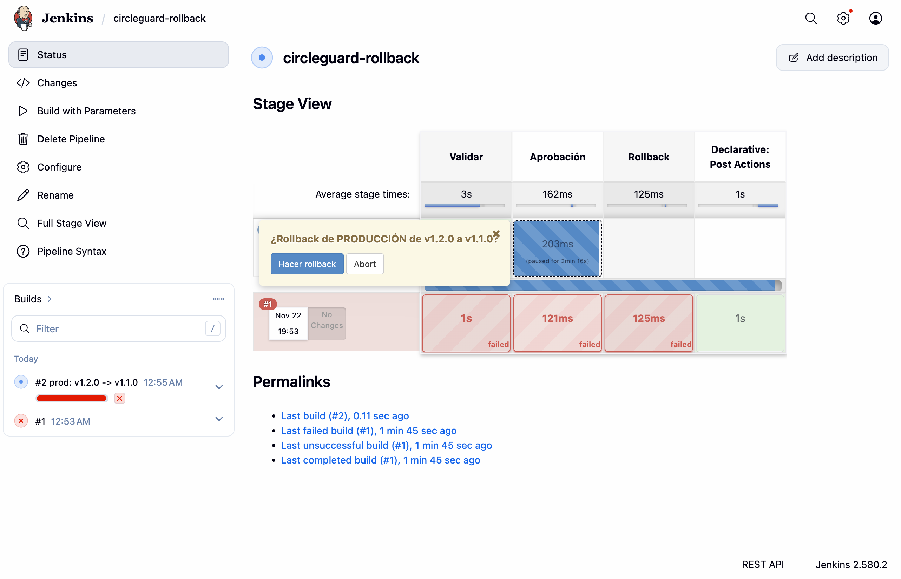
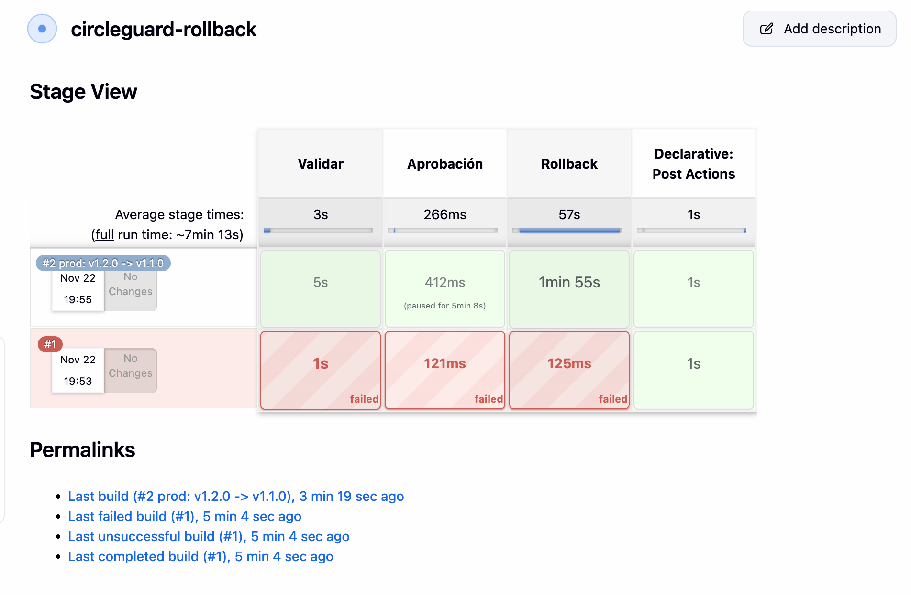

# Plan de rollback (CG-104)

Este documento define cuándo se hace un rollback de CircleGuard, quién lo aprueba, cómo se ejecuta
y cómo se verifica. Incluye la evidencia de la ejecución real del 2026-11-22 y las limitaciones.

Fuente técnica: `jenkins/Jenkinsfile.rollback` y [manual de operaciones §4](../manual-operaciones.md#4-hacer-rollback).

## 1. Cuándo se decide un rollback

Se decide volver a la versión anterior cuando una versión ya desplegada en un ambiente:

- rompe una funcionalidad principal o el servicio no responde;
- dispara alertas que persisten tras el despliegue (ver manual de operaciones, sección de alertas);
- tiene un defecto que no se puede corregir con un despliegue nuevo en tiempo razonable.

La decisión se toma entre el equipo, y el motivo queda escrito en el parámetro `REASON`.

## 2. Quién lo aprueba

- Lo lanza un integrante (quien ejecuta el job).
- En `prod` el job se detiene en el stage `Aprobación` (`input`, timeout de 30 minutos) y solo lo
  pueden aprobar los usuarios de `cgConfig.prodApprovers()` (por defecto `luis`, `simon`, `dario`).
- **Regla del equipo:** quien aprueba debe ser un integrante distinto al que lanza el rollback.
  Esta regla es de proceso; el job no la impone por código (pendiente de evidencia de que Jenkins la fuerce).
- El nombre de quien aprobó queda en el log (`Rollback aprobado por: …`).

## 3. Cómo se ejecuta

Job `circleguard-rollback` → *Build with Parameters*:

| Parámetro | Valor |
|---|---|
| `TARGET_ENV` | `dev`, `stage` o `prod` |
| `ROLLBACK_VERSION` | versión **release** `vX.Y.Z` ya publicada (las `-SNAPSHOT` se rechazan) |
| `REASON` | motivo del rollback (obligatorio) |

Qué hace el job (en `jenkins/Jenkinsfile.rollback`):

1. **Validar:** exige release (`cgConfig.requireRelease`), que `REASON` no esté vacío, que el tag exista en GitHub
   y que el ambiente no esté ya en esa versión.
2. **Aprobación:** solo en `prod`.
3. **Rollback:** `cgDeploy` con la versión pedida (en Kubernetes, `helm upgrade` con `--atomic --wait`), y
   comprueba que el ambiente reporte la versión esperada; si no, falla.
4. Notifica el resultado (`cgNotify`).

No reconstruye nada: las imágenes ya están publicadas.

## 4. Cómo se verifica

1. El log del build muestra `Antes: <N> | Después: <N-1>` y el nombre del build
   `#<n> prod: vN -> vN-1`.
2. Los pods del namespace del ambiente quedan en `Running`/`Ready`.
3. La aplicación responde con la versión esperada.

## 5. Evidencia: ejecución real del 2026-11-22

| Dato | Valor |
|---|---|
| Job | `circleguard-rollback` |
| Ambiente | `prod` |
| Cambio | `v1.2.0` → `v1.1.0` |
| Lanzado por | Luis |
| Aprobado por | Simón Reyes |
| Verificado por | Darío (pods y versión) |
| Build #1 | falló a propósito, solo para que Jenkins cargara los parámetros del job |
| Build #2 | rollback real, exitoso |

Capturas: ver la sección «Capturas de la ejecución» al final de este documento.

## 6. Limitaciones

- El job revierte **las imágenes**, no la configuración del chart. Por ejemplo, el HPA de auth-service
  se queda como estaba tras el rollback.
- El esquema de base de datos no se revierte (Flyway solo avanza), igual que se indica en
  `jenkins/Jenkinsfile.rollback`; las migraciones deben ser compatibles hacia atrás.
- **Alternativa completa:** `helm rollback circleguard <revisión> -n circleguard-prod`, que revierte
  imágenes y configuración. Ver revisiones con `helm history circleguard -n circleguard-prod`.
  Estos comandos no están probados en el repo: pendiente de evidencia.
- **Mejora futura:** que el job use el chart del tag de la versión destino, en lugar del chart actual.

### Capturas de la ejecución (build #2, 2026-11-22)

1. Parámetros del rollback (`TARGET_ENV=prod`, `ROLLBACK_VERSION=v1.1.0`):

   

2. Aprobación manual de producción ("¿Rollback de PRODUCCIÓN de v1.2.0 a v1.1.0?"):

   

3. Rollback terminado en verde:

   
