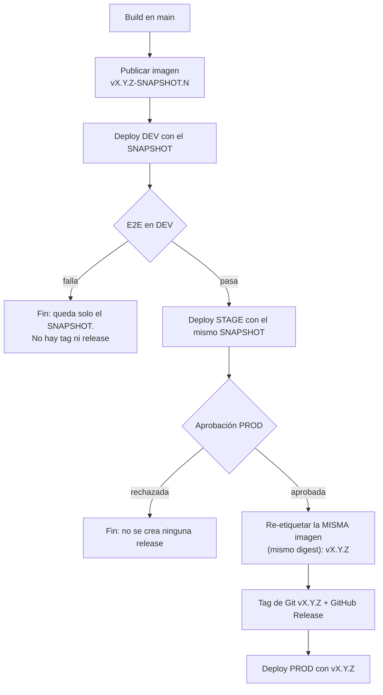

# Versionado Semántico, Publicación de Releases y Plan de Rollback

En CircleGuard, el versionado del software, la publicación de imágenes en el registro de contenedores y la generación de notas de lanzamiento se encuentran 100 % automatizados mediante la integración de **Conventional Commits**, **git-cliff** y el **pipeline multibranch de Jenkins**.

---

## 1. Esquema de Versionado Semántico (SemVer)

CircleGuard implementa el estándar [Semantic Versioning 2.0.0](https://semver.org/) anteponiendo el prefijo `v`:

```text
vMAJOR.MINOR.PATCH                 (release, validada)
vMAJOR.MINOR.PATCH-SNAPSHOT.<N>    (sin validar; N = número de build de Jenkins)
```

Los dos formatos se explican en la sección 2.1.

- **MAJOR**: Incremento ante cambios incompatibles hacia atrás (*breaking changes*), modificaciones drásticas en el protocolo de tokens QR o alteraciones en los contratos de API pública.
- **MINOR**: Incremento ante la adición de nuevas funcionalidades compatibles hacia atrás (ej. soporte para nuevos flujos de encuestas, nuevos dashboards).
- **PATCH**: Incremento ante correcciones de errores (*bug fixes*), mejoras de rendimiento o refactorizaciones internas sin alteración funcional.

### Reglas de consistencia:
- Si el repositorio no posee etiquetas de versión previas, el pipeline asigna automáticamente la versión inicial **`v1.0.0`** (definido en `jenkins/vars/cgVersion.groovy`).
- La función de validación `cgConfig.requireSemver(version)` exige que toda versión cumpla la expresión regular `^v\d+\.\d+\.\d+(-SNAPSHOT\.\d+)?$`: acepta `vX.Y.Z` y `vX.Y.Z-SNAPSHOT.<N>`. Cualquier otro formato (por ejemplo `-SNAPSHOT` sin número, o `latest`) detiene de inmediato el pipeline.

---

## 2. Inmutabilidad de Imágenes en Nexus (Prohibición de `latest`)

Todo componente construido se publica en el registro privado de artefactos Nexus (`CG_REGISTRY`). 

### Política de Contenedores Inmutables:
1. **Etiquetado determinista**: cada imagen se construye y se publica **una sola vez** con la etiqueta SNAPSHOT del build (`vX.Y.Z-SNAPSHOT.<N>`); la etiqueta de release `vX.Y.Z` se agrega después, sobre esa misma imagen, al aprobar prod (sección 2.1):
   ```text
   ${CG_REGISTRY}/circleguard/${NOMBRE_COMPONENTE}:${VERSION}
   ```
   *Ejemplo:* `<registro>/circleguard/promotion-service:v1.2.0-SNAPSHOT.57` (SNAPSHOT) y `<registro>/circleguard/promotion-service:v1.2.0` (release, misma imagen).
2. **Prohibición estricta de `latest`**:
   - La etiqueta `latest` es mutable y oculta qué versión de código se encuentra ejecutando en un contenedor.
   - Rompe la reproducibilidad del entorno y anula la capacidad de auditoría post-mortem.
   - Impide realizar rollbacks deterministas, pues no es posible saber a qué versión apunta `latest` en un momento dado.
3. **Un release = Todo el sistema sincronizado**:
   - En cada release generado en `main`, el pipeline empaqueta y publica los 8 microservicios backend más el cliente web con el **mismo tag de versión** (SNAPSHOT primero y, tras la aprobación, el de release).
   - Los archivos `docker-compose` de cada ambiente leen la variable `VERSION` compartida, garantizando compatibilidad cruzada absoluta entre todos los microservicios.

---

## 2.1 Convención de etiquetas: SNAPSHOT → release (CG-115)

> **Estado:** implementada por Simón en el pipeline (CG-116): dev y stage reciben `vX.Y.Z-SNAPSHOT.<N>` y, al aprobar prod, **la misma imagen (mismo digest)** se promueve a `vX.Y.Z`; solo entonces se crean el tag de Git y el GitHub Release. Darío limpia los SNAPSHOT viejos de Nexus (CG-117). El código del pipeline vive en la rama de Simón y, al escribir esto, aún no está en `main`: la evidencia (build de Jenkins con las etapas nuevas) está **pendiente de evidencia** hasta que se fusione.

Una versión **sin validar** no puede verse igual que una que **ya pasó las pruebas**. Por eso hay dos tipos de etiqueta:

| Tipo | Formato | Ejemplo | Significado | Dónde puede existir |
|---|---|---|---|---|
| SNAPSHOT | `vX.Y.Z-SNAPSHOT.<N>` | `v1.2.0-SNAPSHOT.57` | Imagen construida, todavía sin validar. `<N>` es el número de build de Jenkins. | Solo `dev` y `stage` |
| Release | `vX.Y.Z` | `v1.2.0` | La misma imagen del SNAPSHOT, ya validada en dev y stage y aprobada a mano. | `prod` (la única etiqueta permitida allí) |

`X.Y.Z` lo sigue calculando git-cliff (sección 3). Lo nuevo es el sufijo: mientras la versión no se valide, lleva `-SNAPSHOT.<N>`. `cgConfig.requireSemver` acepta exactamente estos dos formatos (sección 1).

### Flujo



El paso clave es **re-etiquetar**: la release no se vuelve a construir. Es la misma imagen (mismo *digest*) que se probó en stage, con un nombre nuevo. Así lo que llega a producción es, byte a byte, lo que se validó.

### Por qué `-SNAPSHOT.<build>` y no un `-SNAPSHOT` fijo

- Un tag fijo (`v1.2.0-SNAPSHOT`) es **mutable**: cada build lo sobrescribiría. La imagen probada en stage podría ser reemplazada por otra antes de promoverse, y nadie sabría cuál se aprobó.
- Con el número de build cada SNAPSHOT es único y apunta siempre a la misma imagen.
- Nexus está en `writePolicy: ALLOW_ONCE` (ver `docs/infra/topologia.md`): no permite volver a publicar un tag existente. Un `-SNAPSHOT` fijo fallaría en el segundo build. Por eso `requireSemver` exige el número (`-SNAPSHOT.<N>`).

### Qué evita esto: el caso de la v1.0.0

Antes, el tag de Git se creaba en la etapa `Tag + release notes`, **antes** de `Deploy DEV` y de los E2E (así está en el `Jenkinsfile` de `main`). Por eso la v1.0.0 quedó etiquetada en Git aunque los E2E la detuvieron en dev y nunca llegó a producción (`docs/agil/sprint-1.md`, `IAG_REGISTRO.md`). Con la convención nueva, el tag `vX.Y.Z` y el GitHub Release se crean **solo después** de la aprobación de prod, así que un tag de release siempre corresponde a algo validado y aprobado.

### Si se rechaza la aprobación

No se crea ninguna release: ni re-etiquetado, ni tag de Git, ni GitHub Release. Solo queda el SNAPSHOT en Nexus, que no se despliega en prod. El siguiente intento genera un SNAPSHOT nuevo con otro número de build.

---

## 3. Mapeo de Commits y Cálculo Automático de Versión

El cálculo del siguiente número de versión se delega a `git-cliff` mediante la configuración de `cliff.toml`, ejecutada desde `cgVersion.groovy`:

```bash
git cliff --bumped-version
```

### Tabla de resolución de bump:

| Tipo de Commit en `main` | Efecto en la Versión | Comportamiento del Pipeline |
|---|---|---|
| `feat` (ej. `feat(auth): ...`) | **MINOR** (`v1.0.0` → `v1.1.0`) | Se publica SNAPSHOT (`v1.1.0-SNAPSHOT.<N>`) y se despliega a dev/stage; al aprobar prod se re-etiqueta a `v1.1.0`, se crea el tag y se despliega a prod. |
| `fix` (ej. `fix(gateway): ...`) | **PATCH** (`v1.0.0` → `v1.0.1`) | Igual que `feat`, con `v1.0.1`. |
| `perf`, `refactor`, `build` | **PATCH** (`v1.0.0` → `v1.0.1`) | Igual que `feat`, con `v1.0.1`. |
| Commit con `!` o nota `BREAKING CHANGE:` | **MAJOR** (`v1.0.0` → `v2.0.0`) | Igual que `feat`, con `v2.0.0`. |
| `docs`, `chore`, `ci`, `test`, `style` | **Sin release** (`skip = true`) | Si desde el último tag solo existen commits con estos tipos, `cgVersion()` devuelve una cadena vacía (`""`). El pipeline ejecuta la etapa de CI (pruebas y análisis SonarQube) pero **no publica imágenes, no crea tags ni altera los ambientes**. |

---

## 4. Generación y Publicación de Release Notes

El tag y el GitHub Release (`jenkins/vars/cgRelease.groovy`) se crean únicamente **después** de la aprobación de prod y del re-etiquetado `vX.Y.Z` de las imágenes (sección 2.1). Así nunca queda un tag de Git sin una imagen release validada detrás.

### Flujo de publicación:
1. **Creación del tag Git anotado**:
   ```bash
   git tag -a "$RELEASE_VERSION" -m "release $RELEASE_VERSION"
   ```
2. **Generación del documento de Release Notes**:
   Se ejecuta `git-cliff` para extraer únicamente los cambios del último lanzamiento:
   ```bash
   git cliff --latest --strip header --output RELEASE_NOTES.md
   ```
   El archivo generado categoriza los commits en:
   - 🚀 Funcionalidades (*Features*)
   - 🐛 Corrección de Errores (*Bug Fixes*)
   - ⚡ Rendimiento (*Performance*)
   - 🚜 Refactorización (*Refactor*)
   - 📦 Sistema de Compilación (*Build*)
   Cada elemento incluye su alcance (*scope*), descripción y enlace directo al commit en GitHub.
3. **Publicación en GitHub Releases**:
   El pipeline empuja el tag al repositorio remoto y realiza una petición HTTP a la API REST de GitHub creando el release oficial con el contenido de `RELEASE_NOTES.md`.
4. **Archivo de artefacto**:
   El archivo `RELEASE_NOTES.md` se archiva permanentemente en el build de Jenkins (`archiveArtifacts`).

---

## 5. Procedimiento de Rollback (Reversión Operativa)

Cuando se identifica un incidente en producción que compromete la operación normal y no puede resolverse inmediatamente con un hotfix, se activa el procedimiento de rollback mediante el pipeline dedicado `jenkins/Jenkinsfile.rollback`.

### Principio Fundamental del Rollback:
Dado que las imágenes Docker son inmutables y permanecen almacenadas en el registro Nexus, hacer rollback **no requiere recompilar código ni reejecutar pruebas**. Se trata de un redespliegue directo de una versión previa conocida y estable, reduciendo el RTO (*Recovery Time Objective*) a menos de 3 minutos.

### Pasos de ejecución del Rollback:
1. **Ejecución del Job en Jenkins**:
   - Navegar al job `circleguard-rollback` y presionar **Build with Parameters**.
   - Parámetros:
     - `TARGET_ENV`: Ambiente objetivo (`dev`, `stage` o `prod`).
     - `ROLLBACK_VERSION`: Versión anterior válida a la que se desea retornar (ej. `v1.0.0`).
     - `REASON`: Justificación obligatoria del rollback para fines de auditoría.
2. **Validación Automática**:
   - El pipeline verifica que `ROLLBACK_VERSION` cumpla el formato SemVer (`requireSemver`; en la práctica, una release `vX.Y.Z`).
   - Comprueba mediante `git ls-remote` que el tag existe en GitHub. Solo las releases tienen tag de Git (los SNAPSHOT no), así que el rollback apunta a una release anterior.
   - Valida que la versión actual del ambiente no sea ya igual a la versión solicitada.
3. **Compuerta de Aprobación (solo para `prod`)**:
   - Si `TARGET_ENV` es `prod`, el pipeline solicita aprobación interactiva con un timeout de 30 minutos, restringido a los usuarios de `CG_PROD_APPROVERS` (`luis`, `simon`, `dario`).
4. **Redespliegue vía SSH**:
   - Jenkins se conecta al servidor correspondiente e invoca `cgDeploy`, el cual actualiza el archivo de variables del ambiente con la versión previa y ejecuta:
     ```bash
     docker compose pull
     docker compose up -d --remove-orphans
     ```
5. **Verificación y Notificación**:
   - Se consulta la versión activa post-despliegue confirmando que coincide con `ROLLBACK_VERSION`.
   - Se envía una notificación prioritaria a los canales del equipo detallando el ambiente, versión anterior, versión restaurada, usuario aprobador y motivo.

### Consideración sobre Bases de Datos (Flyway):
Las herramientas de migración relacional como Flyway están diseñadas para avanzar hacia adelante. Por este motivo, el equipo sigue el principio de **Migraciones Expand/Contract**: nunca se eliminan columnas o tablas en la misma versión en la que se introducen cambios de código, garantizando que el esquema de base de datos continúe siendo compatible con la versión inmediatamente anterior durante un rollback.
