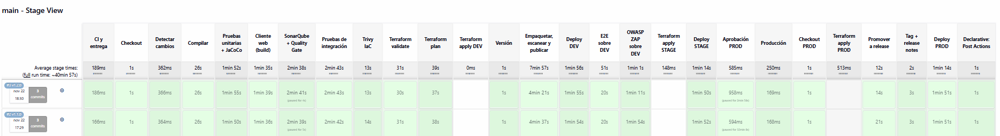
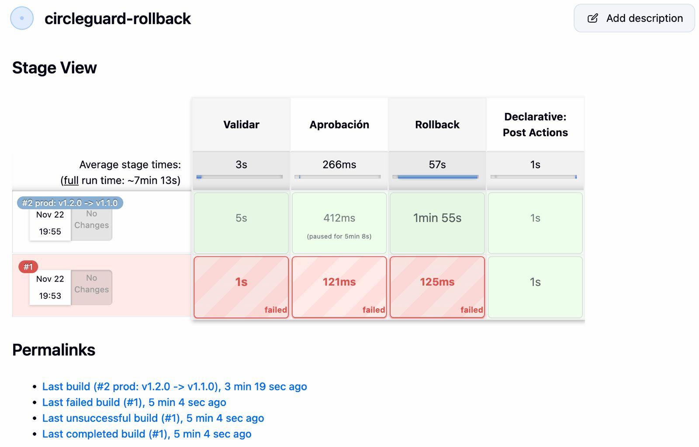
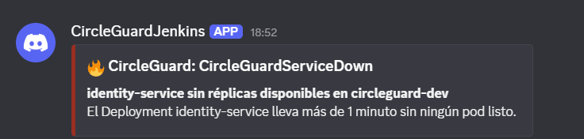
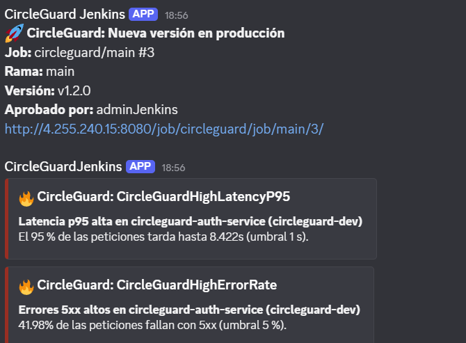
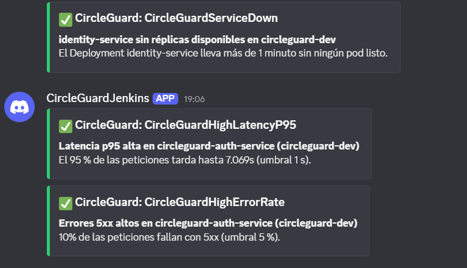

# Evidencia del Sprint 2: pipeline, seguridad y alertas

Evidencia de las historias del Sprint 2 sobre el clúster k3s (ambientes `circleguard-dev`, `circleguard-stage` y `circleguard-prod`), tomada el 2026-11-22. Los reportes completos quedan como artefactos de cada build en Jenkins:

- Build #2 de `main` (v1.1.0): http://4.255.240.15:8080/job/circleguard/job/main/2/
- Build #3 de `main` (v1.2.0): http://4.255.240.15:8080/job/circleguard/job/main/3/
- Artefactos del build #3 (Trivy, ZAP, plan de Terraform, promoción, release notes): http://4.255.240.15:8080/job/circleguard/job/main/3/artifact/

---

## 1. Versiones desplegadas

| Build | Versión | Contenido | Aprobó prod | Resultado |
|---|---|---|---|---|
| `main` #1 | v1.1.0-SNAPSHOT.1 | Código del Sprint 2 (#67 a #75) | No llegó | Falló en E2E sobre DEV (ver sección 8) |
| `main` #2 | **v1.1.0** | Código del Sprint 2 (#67 a #75) + #84: corrección de CORS detrás de Traefik | dario | Desplegado en prod |
| `main` #3 | **v1.2.0** | #85: HPA de auth-service (recomendación de la prueba de estrés) | adminJenkins (Simón, con la cuenta de administrador) | Desplegado en prod |
| `circleguard-rollback` #2 | v1.2.0 → **v1.1.0** | Rollback de prod (CG-104) | Aprobación manual | Prod vuelve a v1.1.0 |

Releases en GitHub: [v1.1.0](https://github.com/ingesoft5/circle-guard-finalproject-A00395967-A00400880-A00401286/releases/tag/v1.1.0) y [v1.2.0](https://github.com/ingesoft5/circle-guard-finalproject-A00395967-A00400880-A00401286/releases/tag/v1.2.0).

---

## 2. Pipeline completo hasta producción (CG-89, CG-91, CG-116)

Builds #2 y #3 de `main`, todas las etapas en verde: compilación, pruebas unitarias e integración, SonarQube, Trivy, Terraform (validate y plan por ambiente), publicación SNAPSHOT, deploy con Helm a dev, E2E, ZAP, deploy a stage, aprobación manual, promoción a release, tag y deploy a prod.

- **Terraform (CG-89):** el plan de dev, stage y prod dio *"No changes. Your infrastructure matches the configuration."*, por eso las etapas *Terraform apply* no se ejecutan (solo aplican cuando el plan trae cambios).
- **Helm (CG-91):** `helm upgrade --install --atomic --wait` en cada namespace; si un pod no queda listo, Helm deshace el cambio.
- **SNAPSHOT → release (CG-116):** stage y dev reciben `v1.2.0-SNAPSHOT.3`; con la aprobación, `crane` copia la misma imagen a `v1.2.0` sin reconstruirla. El digest es el mismo antes y después:

| Imagen | SNAPSHOT → release | Digest |
|---|---|---|
| auth-service | v1.2.0-SNAPSHOT.3 → v1.2.0 | `sha256:727a6374c873…` |
| identity-service | v1.2.0-SNAPSHOT.3 → v1.2.0 | `sha256:2225283e7478…` |
| promotion-service | v1.2.0-SNAPSHOT.3 → v1.2.0 | `sha256:b983237065f5…` |
| form-service | v1.2.0-SNAPSHOT.3 → v1.2.0 | `sha256:9ff426175672…` |
| gateway-service | v1.2.0-SNAPSHOT.3 → v1.2.0 | `sha256:9e69860056d9…` |
| notification-service | v1.2.0-SNAPSHOT.3 → v1.2.0 | `sha256:038c4ab3b610…` |
| file-service | v1.2.0-SNAPSHOT.3 → v1.2.0 | `sha256:c2b060079df7…` |
| dashboard-service | v1.2.0-SNAPSHOT.3 → v1.2.0 | `sha256:f7a12ec24e7d…` |
| web | v1.2.0-SNAPSHOT.3 → v1.2.0 | `sha256:742e9bbce4ab…` |

Fuente: artefacto `promotion.txt` del build #3.

---

## 3. Calidad: SonarQube y Quality Gate

La etapa *SonarQube + Quality Gate* pasó en los builds #2 y #3 (ver Stage View). El pipeline espera la respuesta del quality gate y se detiene si no es OK. El PR #26 (*DO NOT MERGE: demo quality gate blocks the pipeline*) muestra el caso contrario: un quality gate fallido detiene el pipeline.

---

## 4. Trivy: escaneo de imágenes e IaC (CG-90)

Cada imagen se escanea **antes** de publicarse en Nexus. El build se detiene si hay vulnerabilidades CRITICAL con arreglo disponible (`--ignore-unfixed`). Las 3 excepciones aceptadas de Spring están en `.trivyignore` y en [riesgos-aceptados.md](../../change-management/riesgos-aceptados.md).

Resultado del build #3 (v1.2.0):

| Imagen | CRITICAL | HIGH | MEDIUM | LOW |
|---|---|---|---|---|
| auth-service | 0 | 19 | 29 | 9 |
| identity-service | 0 | 24 | 37 | 10 |
| promotion-service | 0 | 24 | 41 | 10 |
| form-service | 0 | 23 | 39 | 10 |
| gateway-service | 0 | 16 | 28 | 9 |
| notification-service | 0 | 26 | 48 | 12 |
| file-service | 0 | 16 | 25 | 9 |
| dashboard-service | 0 | 17 | 27 | 9 |
| web | 0 | 55 | 83 | 96 |

El escaneo de IaC (`deploy/helm` e `infra/terraform`) no tuvo hallazgos CRITICAL. Reportes completos: `trivy-reports/` en los artefactos del build.

---

## 5. OWASP ZAP baseline sobre dev (CG-92)

Escaneo pasivo contra `https://dev.40-64-120-3.sslip.io` antes de promover a stage. Las reglas están en `tests/security-zap/zap-baseline.conf` (FAIL bloquea, WARN queda en el reporte). Resultado del build #3: **0 hallazgos FAIL**.

| Riesgo | Hallazgo | Regla | Nivel en el pipeline |
|---|---|---|---|
| Alto | nginx Version with Known Vulnerabilities | 20020 | WARN |
| Medio | Content Security Policy (CSP) Header Not Set | 10038 | WARN |
| Medio | Missing Anti-clickjacking Header | 10020 | WARN |
| Bajo | Cross-Origin-Embedder/Opener/Resource-Policy Header Missing | 90004 | WARN |
| Bajo | Dangerous JS Functions | 10110 | WARN |
| Bajo | Permissions Policy Header Not Set | 10063 | WARN |
| Bajo | Server Leaks Version Information via "Server" Header | 10036 | WARN |
| Bajo | Strict-Transport-Security Header Not Set | 10035 | IGNORE |
| Bajo | Timestamp Disclosure - Unix | 10096 | IGNORE |
| Bajo | X-Content-Type-Options Header Missing | 10021 | WARN |

**Pendiente identificado:** el hallazgo alto 20020 aparece porque nginx publica su versión en la cabecera `Server` (10036). La corrección propuesta es `server_tokens off;` y los encabezados de endurecimiento (CSP, X-Frame-Options, X-Content-Type-Options) en el nginx del chart. Reporte completo: `zap-reports/zap-baseline.html` en los artefactos del build.

---

## 6. Rollback de producción (CG-104)

Job `circleguard-rollback` con `TARGET_ENV=prod` y `ROLLBACK_VERSION=v1.1.0`. Redespliega con Helm la release anterior, que ya existe en Nexus, sin reconstruir nada, y pide aprobación manual por ser prod.

- El build #1 falló en *Validar* porque es la primera ejecución del job: Jenkins todavía no conocía los parámetros. El #2 corrió con ellos.
- Limitación conocida: el rollback cambia las imágenes, pero usa el chart de `main`, así que el HPA de auth-service (v1.2.0) se mantiene. Igual que Flyway no revierte el esquema, el rollback no revierte la configuración del chart.

---

## 7. Alertas a Discord (CG-95)

Se dispararon las 3 alertas en `circleguard-dev`. Alertmanager solo envía a Discord las alertas `CircleGuard.*`. Los tres avisos llegaron y luego se resolvieron solos (0 fallos de envío).

| Alerta | Se disparó | Se resolvió |
|---|---|---|
| CircleGuardServiceDown (identity-service sin réplicas) | 18:52 | 19:06 |
| CircleGuardHighLatencyP95 (auth-service, p95 = 8.4 s, umbral 1 s) | 18:56 | 19:06 |
| CircleGuardHighErrorRate (auth-service, 42 % de 5xx, umbral 5 %) | 18:56 | 19:06 |

---

## 8. Incidente durante la entrega: login con 403 detrás de Traefik

El build #1 de `main` falló en *E2E sobre DEV*: 6 de 9 pruebas, todas con el login en **403 "Invalid CORS request"**. En Kubernetes el TLS termina en Traefik: el navegador envía `Origin: https://…`, pero a nginx y a Spring la petición les llega por http, y Spring la trata como de otro origen. Se reprodujo contra dev (sin `Origin` respondía 200; con `Origin`, 403). Afectaba también a stage y a prod.

Corrección en el PR #84: el nginx del chart quita `Origin` cuando coincide con el mismo host; otro origen se sigue enviando y Spring lo rechaza. Con eso el build #2 pasó **9 de 9 E2E** y el login desde el navegador responde 200 en los 3 ambientes. El pipeline cumplió su función: la versión con el error no pasó de dev.

---

## 9. Resiliencia (CG-98, CG-99)

Los patrones Circuit Breaker (dashboard → promotion) y Retry (auth → identity) están documentados en [resiliencia.md](../../patrones/resiliencia.md) y se verifican con pruebas unitarias en cada build (`PromotionClient` e `IdentityClient`).
