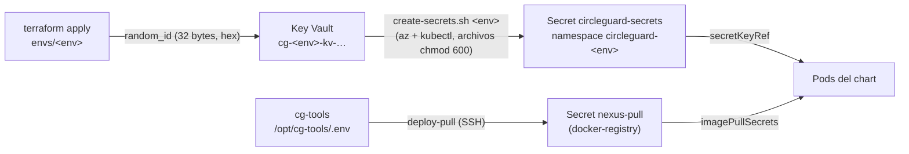

# Secretos: de dónde salen y cómo llegan a Kubernetes (CG-82, CG-87)

Ningún secreto se escribe a mano, se versiona ni pasa por el chat.



| Secreto | Origen | Lo usa |
|---|---|---|
| `postgres-password`, `neo4j-password`, `ldap-admin-password` | Key Vault del ambiente (Terraform) | middleware y servicios con base de datos |
| `jwt-secret`, `qr-secret` | Key Vault del ambiente | auth, identity, promotion, notification, gateway |
| `vault-secret`, `vault-salt` | Key Vault del ambiente | identity (cifrado de identidades; **no rotar con datos**) |
| `nexus-pull` | `bootstrap-tools.sh` en cg-tools (usuario de solo lectura) | kubelet, para bajar imágenes |
| kubeconfig de Jenkins | `infra/k8s/jenkins-access.sh` (token de ServiceAccount) | credencial `kubeconfig-circleguard` de Jenkins |
| Estado de Terraform | Storage Account `cgtfstate…`: cifrado, solo Azure AD | Terraform (contiene los valores generados) |

## Crear o actualizar los Secrets de un ambiente

```bash
export KUBECONFIG=~/.kube/circleguard.yaml
./deploy/helm/create-secrets.sh dev      # idem stage, prod; idempotente
```

- Cada ambiente tiene secretos **distintos**: un JWT de dev no sirve en prod.
- Los Secrets de Kubernetes se cifran en reposo (`secrets-encryption` de k3s).
- El Key Vault tiene firewall: solo entran la IP del administrador y la de
  Jenkins (`allowed_ips` del módulo `secrets`).

## Rotar

| Qué | Cómo |
|---|---|
| JWT, QR, contraseñas de middleware | `terraform apply -replace='module.secrets.random_id.this["jwt-secret"]'` en `envs/<env>`, luego `create-secrets.sh <env>` y `kubectl rollout restart deploy -n circleguard-<env>`. Las contraseñas de Postgres, Neo4j y LDAP también se cambian dentro de la base (la imagen solo las lee con el volumen vacío) |
| `vault-secret`, `vault-salt` | No se rotan con datos: los registros cifrados ya no se podrían leer |
| Token de Jenkins | `kubectl delete secret -n cicd jenkins-deployer-token` y `infra/k8s/jenkins-access.sh` |

## Escaneo de secretos

```bash
gitleaks dir . && gitleaks git .                      # árbol actual e historial
trivy fs --scanners secret --skip-dirs node_modules .
```

Resultado del 21/11/2026: **0 hallazgos** en ambos. Los 5 falsos positivos
revisados (contraseña de fábrica de SonarQube y claves fijas de las pruebas)
están en [`.gitleaksignore`](../../.gitleaksignore), cada uno con su motivo.

**Pendiente para el dueño de identity-service:** `src/main/resources/application.yml`
trae un `vault.secret` de prueba por defecto. En los ambientes siempre se
reemplaza por `VAULT_SECRET`. Aun así, lo correcto es que no haya valor por
defecto en `main` y que el servicio no arranque sin la variable.
