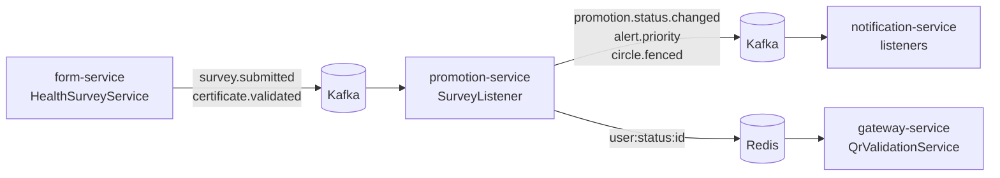
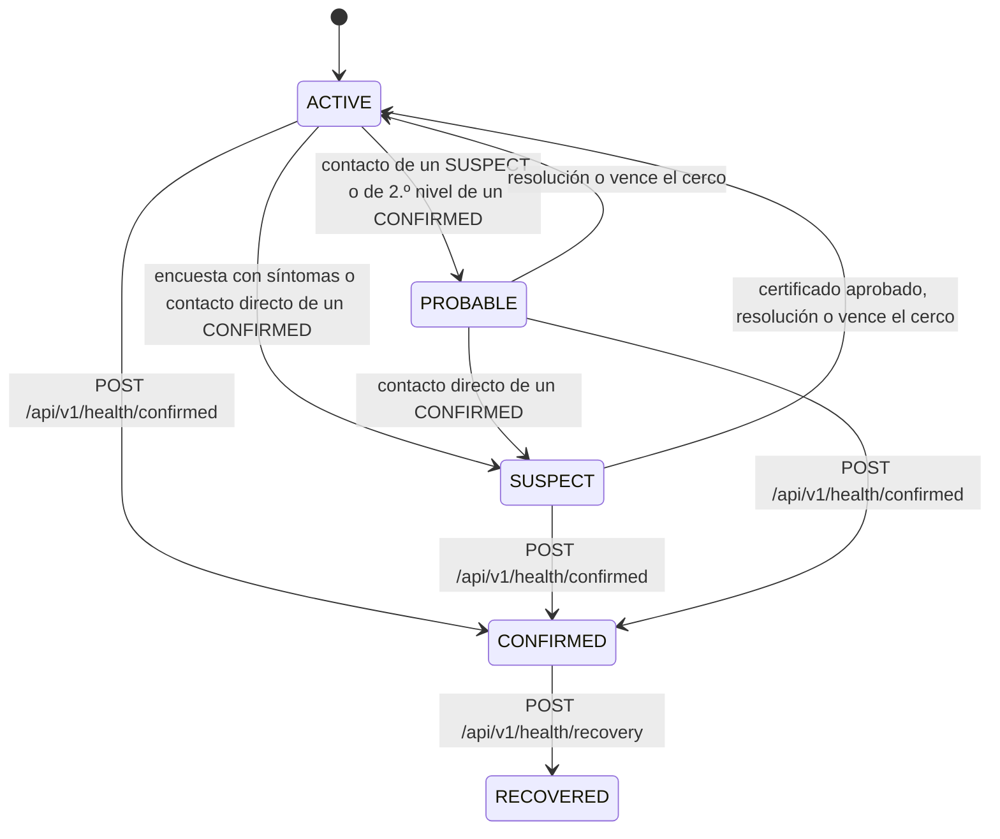

# Patrones de diseño en CircleGuard

Este documento lista los patrones de arquitectura que **ya existen en el código** de CircleGuard
y deja el espacio para los tres patrones nuevos de la Parte 2.

**Regla de evidencia.** Cada patrón señala el archivo y la clase donde se ve. Si un patrón se
menciona en otros documentos pero no aparece en el código, queda en la sección
[No verificado](#no-verificado) en lugar de afirmarlo.

Estados usados en la tabla:

- **Verificado:** el patrón está en el código y se usa en el flujo real.
- **Parcial:** una parte del patrón está en el código, pero no el patrón completo o no se usa en el flujo real.

## Resumen

| Patrón | Dónde está (ruta y clase) | Cómo funciona | *Trade-off* | Estado |
|---|---|---|---|---|
| Base de datos por servicio (*database-per-service*) | `init-db.sql`; `spring.datasource.url` en `services/*/src/main/resources/application.yml`; `deploy/docker-compose.yml` | Cada servicio con persistencia relacional tiene su propia base: `circleguard_auth`, `circleguard_identity`, `circleguard_promotion`, `circleguard_dashboard` y `circleguard_form` | Los servicios evolucionan su esquema sin afectar a otros, pero no hay *joins* entre bases y los datos se comparten por eventos o HTTP. Hoy las 5 bases viven en **una sola instancia** de Postgres con **el mismo usuario** | Verificado (aislamiento lógico) |
| Arquitectura dirigida por eventos | Productor: `HealthSurveyService` (form-service). Consumidores: `SurveyListener` (promotion-service), `ExposureNotificationListener`, `PriorityAlertListener` y `CircleFencedListener` (notification-service) | Los servicios publican eventos en temas de Kafka y otros servicios los consumen sin llamarse directamente | Bajo acoplamiento y tolerancia a que un consumidor esté caído, a cambio de consistencia eventual y de un flujo más difícil de seguir y depurar | Verificado |
| Máquina de estados (estados de salud) | `HealthStatusService`, `StatusLifecycleService`, `SurveyListener` y `HealthStatusController` (promotion-service) | El usuario pasa por `ACTIVE`, `SUSPECT`, `PROBABLE`, `CONFIRMED` y `RECOVERED`. Cada transición la dispara un evento, un endpoint o una tarea programada | Las reglas del negocio quedan explícitas (cerco obligatorio, propagación a contactos), pero las transiciones están repartidas en varias clases y consultas Cypher, sin una tabla única de transiciones permitidas | Verificado (implícita) |
| Vista materializada (*materialized view*) en Redis | Escribe: `HealthStatusService.updateRedisInBatches` y `StatusLifecycleService` (promotion-service). Lee: `QrValidationService.validateToken` (gateway-service) | promotion-service calcula el estado en Neo4j y lo copia a Redis con la clave `user:status:<anonymousId>`. gateway-service solo lee esa clave para abrir o no el torniquete | Lectura en milisegundos sin consultar el grafo, a cambio de consistencia eventual. Si la clave no existe, gateway **permite el ingreso** (falla abierta) | Verificado |
| *Cache-aside* | `CacheConfig` y `HealthStatusService.getCachedStatus` (promotion-service) | `@Cacheable("userStatus")` busca primero en una caché local Caffeine y, si no está, lee Redis y guarda el resultado por 5 minutos | Menos lecturas a Redis, pero el dato puede estar viejo hasta 5 minutos. **El método solo se llama desde pruebas**, no desde el código de producción | Parcial |
| Enrutamiento en un punto de entrada (*gateway routing*) | `mobile/nginx/default.conf` (cliente web) | nginx recibe todo en un solo origen y reenvía `/svc/<servicio>/*` al microservicio correspondiente | El navegador habla con un solo origen y se evitan problemas de CORS, pero nginx no autentica, no limita tráfico ni agrega respuestas: cada servicio valida su propio JWT | Parcial (ver [API Gateway](#api-gateway)) |
| Endpoint de salud (*health endpoint monitoring*) | Bloque `management.endpoint.health.probes` en el `application.yml` de los 8 servicios | Spring Actuator expone `/actuator/health/liveness` y `/actuator/health/readiness`. La *readiness* incluye las dependencias (por ejemplo `redis` en gateway, `db` y `neo4j` en promotion) | Kubernetes sabe cuándo enviar tráfico o reiniciar un pod, pero si una dependencia compartida cae, todos los pods que dependen de ella dejan de estar listos a la vez | Verificado |

## Detalle de cada patrón

### Base de datos por servicio

- **Evidencia:** `init-db.sql` crea 5 bases. Cada servicio apunta solo a la suya en
  `spring.datasource.url`, por ejemplo `jdbc:postgresql://localhost:5432/circleguard_form` en
  `services/circleguard-form-service/src/main/resources/application.yml`, y lo mismo en
  `SPRING_DATASOURCE_URL` de `deploy/docker-compose.yml`.
- **Qué no tiene base relacional:** gateway-service solo usa Redis; notification-service y
  file-service no declaran `spring.datasource`. promotion-service, además de Postgres, usa Neo4j
  para el grafo de contactos.
- **Límite honesto:** el aislamiento es **lógico**, no físico. Las 5 bases están en el mismo
  contenedor `postgres:16` y todos los servicios usan el mismo `SPRING_DATASOURCE_USERNAME`, así que
  técnicamente un servicio podría conectarse a la base de otro. Un usuario por base cerraría ese hueco.

### Arquitectura dirigida por eventos

Temas de Kafka que tienen productor y consumidor en el repositorio:

| Tema | Productor (clase) | Consumidor (clase) |
|---|---|---|
| `survey.submitted` | `HealthSurveyService.submitSurvey` (form) | `SurveyListener.onSurveySubmitted` (promotion) |
| `certificate.validated` | `HealthSurveyService.validateSurvey` (form) | `SurveyListener.onCertificateValidated` (promotion) |
| `promotion.status.changed` | `HealthStatusService`, `StatusLifecycleService` (promotion) | `ExposureNotificationListener` (notification) |
| `alert.priority` | `HealthStatusService.updateStatus` (promotion) | `PriorityAlertListener` (notification) |
| `circle.fenced` | `HealthStatusService.checkAndBroadcastFencedCircles` (promotion) | `CircleFencedListener` (notification) |

Hay tres temas que se publican pero **no tienen consumidor en el repositorio**:
`proximity.detected` (`LocationResolutionService`), `audit.identity.accessed`
(`IdentityVaultController`) y `notification.audit` (`AuditLogService`).

**Riesgo que conviene conocer:** los *listeners* capturan la excepción y solo la registran en el log
(`SurveyListener`). Si el procesamiento falla, el evento no se reintenta; esto se relaciona con el
patrón Retry de la Parte 2.

### Máquina de estados de salud

No es el patrón *State* de GoF ni usa Spring Statemachine: los estados son cadenas de texto y las
transiciones están en el código de promotion-service. Transiciones que se pueden señalar:

Los endpoints de `HealthStatusController` exigen el rol `HEALTH_CENTER`. En `RECOVERED`,
`promoteToRecovered` pone un vencimiento de 30 días a la clave de Redis; el estado en Neo4j no cambia
cuando la clave vence.

- **Propagación:** en `HealthStatusService.updateStatus`, si el usuario pasa a `CONFIRMED`, sus
  contactos directos pasan a `SUSPECT` y los de segundo nivel que estén en `ACTIVE`, a `PROBABLE`. Si
  pasa a `SUSPECT`, sus contactos directos pasan a `PROBABLE`.
- **Guarda (regla que bloquea una transición):** `checkFenceWindow` lanza `FenceException` si alguien
  en `SUSPECT` o `PROBABLE` intenta volver a `ACTIVE` antes de cumplir `mandatoryFenceDays`, salvo que
  venga `adminOverride`.
- **Transición por tiempo:** `StatusLifecycleService.processAutomaticTransitions` corre cada hora
  (`@Scheduled(cron = "0 0 * * * *")`) y libera a quienes ya cumplieron el cerco.
- **Límite:** `POST /api/v1/health/report` (`HealthStatusController.reportStatus`) acepta el estado
  que llegue en la petición; no hay una lista de transiciones permitidas que lo valide.

### Vista materializada en Redis

- promotion-service escribe en lote (`multiSet` de hasta 2000 claves) el estado del usuario y de los
  contactos afectados después de cada cambio en Neo4j.
- gateway-service no conoce Neo4j ni Kafka: lee `user:status:<anonymousId>` y niega el ingreso si el
  valor está en `DENIED_STATUSES` (`SUSPECT`, `PROBABLE`, `CONFIRMED` y dos valores antiguos).
- **Trade-off principal:** la escritura en Neo4j y la escritura en Redis no son atómicas. Si Redis
  falla después de actualizar Neo4j, el torniquete ve el estado anterior. Y como una clave ausente se
  interpreta como "sin riesgo", la falla es **abierta**: se prefiere no bloquear a estudiantes sanos.

### *Cache-aside*

- `CacheConfig` registra un `CaffeineCacheManager` (caché en memoria de cada instancia, no en Redis)
  con `expireAfterWrite(5, MINUTES)` y las cachés `userStatus`, `proximityMatches`,
  `buildingMetadata` y `systemSettings`.
- Solo `userStatus` tiene anotaciones: `@Cacheable` en `getCachedStatus` y `@CacheEvict` en
  `updateStatus` (borra toda la caché) y `evictUserCache`.
- **Por qué es parcial:** `getCachedStatus` solo se invoca desde `AdministrativeCorrectionTest` y
  `HealthStatusServicePropagationTest`. El código de producción no lo llama, así que hoy la caché no
  acelera ningún flujo real. Las otras tres cachés están declaradas pero sin uso.

### API Gateway

`gateway-service` **no es un API Gateway**, aunque el nombre lo sugiera. Es la validación del
torniquete físico: `GateController` expone `POST /api/v1/gate/validate` y `QrValidationService`
verifica la firma del QR y consulta Redis. No enruta peticiones hacia otros servicios.

Lo más cercano a un API Gateway es nginx en `mobile/nginx/default.conf`, que cumple solo la parte de
**enrutamiento**: un punto de entrada que reenvía `/svc/<servicio>/*`. La autenticación no está
centralizada: `JwtAuthenticationFilter` existe por separado en auth-service, identity-service y
promotion-service.

### Endpoint de salud

Los 8 servicios activan `management.endpoint.health.probes.enabled: true` y definen el grupo
`readiness`: auth, identity, form y dashboard incluyen `db`; gateway, `redis`; promotion, `db` y
`neo4j`; file y notification, solo `readinessState`. Ejemplo en
`services/circleguard-gateway-service/src/main/resources/application.yml`:
`include: readinessState, redis`. Los *probes* de Kubernetes que consumen estos endpoints están en
el chart de Darío (`deploy/helm`).

## No verificado

Afirmaciones que aparecen como candidatas o en otros documentos y que el código **no** respalda:

| Afirmación | Qué se encontró |
|---|---|
| "`gateway-service` es el API Gateway" | Falso: valida QR de torniquetes. Ver [API Gateway](#api-gateway) |
| "Redis se usa como *cache-aside*" | Redis no es una caché delante de una base: es la vista de lectura que escribe promotion-service. El *cache-aside* real usa Caffeine y no se llama en producción |
| "API Gateway completo (autenticación, límite de tráfico, agregación)" | No hay ninguna de esas funciones en nginx ni en otro componente |

## Patrones nuevos de la Parte 2

### Circuit Breaker

> **Responsable:** Simón. Pendiente de implementación.

- **Dónde está (ruta y clase):** _pendiente_
- **Cómo funciona:** _pendiente_
- **Configuración:** _pendiente_
- **Trade-off:** _pendiente_
- **Evidencia (prueba o captura):** _pendiente de evidencia_

### Retry

> **Responsable:** Simón. Pendiente de implementación.

- **Dónde está (ruta y clase):** _pendiente_
- **Cómo funciona:** _pendiente_
- **Configuración:** _pendiente_
- **Trade-off:** _pendiente_
- **Evidencia (prueba o captura):** _pendiente de evidencia_

### Feature Toggle

> **Responsable:** Luis. Pendiente de implementación (CG-101).

- **Funcionalidad que se prende o apaga:** _pendiente_
- **Propiedad y variable de entorno:** _pendiente_
- **Valor por defecto y por qué es seguro:** _pendiente_
- **Dónde está (ruta y clase):** _pendiente_
- **Trade-off:** _pendiente_
- **Evidencia (prueba o captura):** _pendiente de evidencia_

## Para la sustentación

- **Base de datos por servicio:** cada servicio guarda sus datos en su propia base y nadie lee la
  base de otro. Así un cambio de tablas en form no rompe a auth. Si preguntan por qué todas están en
  el mismo Postgres: es aislamiento lógico para ahorrar recursos. El siguiente paso sería un usuario
  por base.
- **Dirigida por eventos:** form no llama a promotion. Deja un mensaje en Kafka ("llegó una encuesta
  con síntomas") y promotion lo procesa cuando puede. Si promotion está caído, el mensaje espera. El
  costo es que los datos se actualizan unos instantes después, no al mismo tiempo.
- **Máquina de estados:** una persona siempre está en uno de cinco estados de salud y solo cambia por
  causas definidas: encuesta, confirmación médica, certificado o paso del tiempo. Si preguntan por qué
  es "implícita": no hay una clase única con las reglas; están repartidas en el servicio, y eso es una
  mejora posible.
- **Vista materializada en Redis:** promotion hace el cálculo pesado en el grafo y deja la respuesta
  lista en Redis. El torniquete solo lee una clave y responde en milisegundos. Si Redis no tiene el
  dato, la puerta deja pasar: se eligió no bloquear a gente sana.
- ***Cache-aside*:** existe en el código, pero hoy no se usa en producción. Decirlo así es más fuerte
  que exagerarlo.
- **API Gateway:** `gateway-service` no es un API Gateway, a pesar del nombre: es el validador de los
  torniquetes. nginx hace el enrutamiento, pero no la seguridad central.
- **Endpoint de salud:** cada servicio responde "estoy vivo" y "estoy listo". Kubernetes usa eso para
  reiniciar un pod colgado o para no mandarle tráfico mientras arranca.
