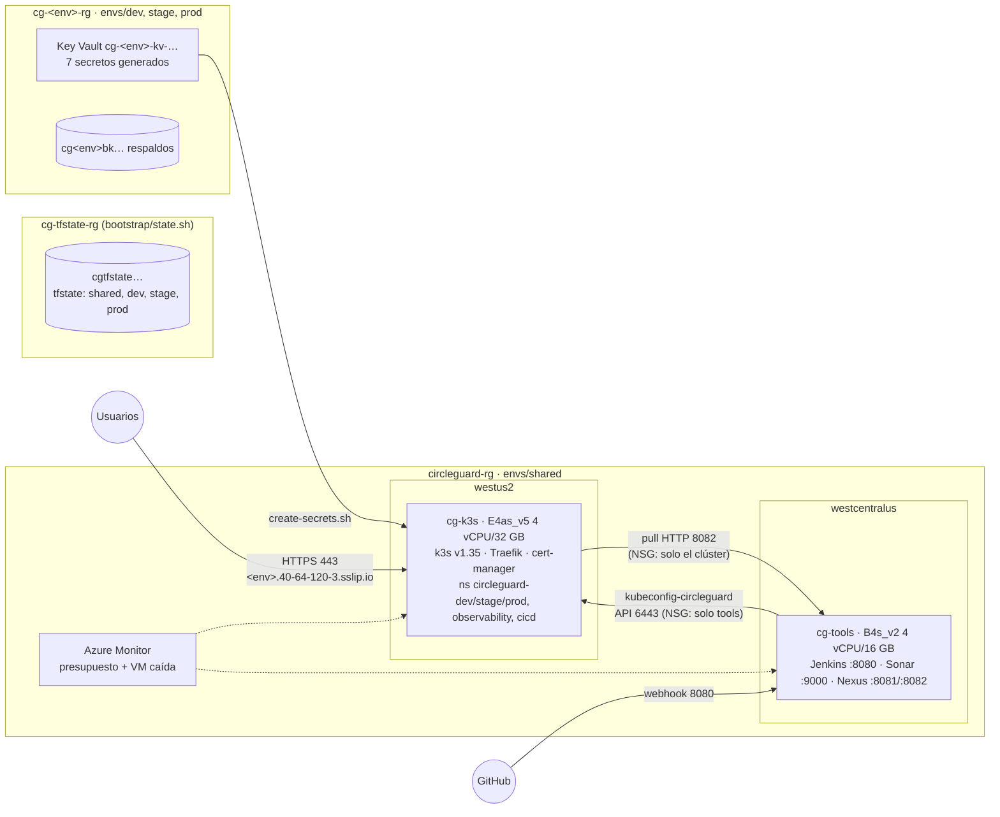

# Infraestructura con Terraform (Parte 2)

```
infra/terraform/
├── bootstrap/state.sh     # crea UNA vez el backend del estado (CG-79)
├── modules/               # network, cluster, registry, storage, secrets, observability (CG-77)
└── envs/
    ├── shared/            # plataforma común: clúster k3s, tools, monitoreo (CG-78, CG-80)
    └── {dev,stage,prod}/  # solo llaman a los módulos y cambian valores (CG-78)
```

## Qué está desplegado (21/11/2026)



| Raíz | Qué crea | La aplica |
|---|---|---|
| `envs/shared` | Red, NSG e IP de cada VM, nodo k3s, VM tools, alertas y presupuesto | El administrador (una vez; cambia poco) |
| `envs/dev`, `stage`, `prod` | Key Vault con secretos generados y cuenta de respaldos | Jenkins: plan en PR, apply en `main` (prod con aprobación) |

Reconstruir todo desde cero:

```bash
./infra/terraform/bootstrap/state.sh                                          # 1. estado (una vez)
cp infra/terraform/envs/shared/terraform.tfvars{.example,}                    # 2. tu IP y correo
terraform -chdir=infra/terraform/envs/shared init && terraform -chdir=infra/terraform/envs/shared apply
for e in dev stage prod; do terraform -chdir=infra/terraform/envs/$e init && terraform -chdir=infra/terraform/envs/$e apply; done
./infra/azure/bootstrap-all.sh tools                                          # 3. Jenkins, Sonar y Nexus
KUBECONFIG=~/.kube/circleguard.yaml ./infra/k8s/tls/install.sh                # 4. cert-manager
KUBECONFIG=~/.kube/circleguard.yaml ./infra/k8s/jenkins-access.sh             # 5. kubeconfig de Jenkins
for e in dev stage prod; do ./deploy/helm/create-secrets.sh $e; done          # 6. Secrets
```

Costo aproximado: ~USD 10–11 por día (las dos VMs suman ~95 %). Apagar sin borrar:
`az vm deallocate --ids $(az vm list -g circleguard-rg --query "[].id" -o tsv)`.

### Kubeconfig de administrador

El clúster lo genera en `/etc/rancher/k3s/k3s.yaml` (modo 600, con `tls-san`
para la IP pública). Se baja por SSH con la llave del administrador, que es la
única que la VM acepta, y se cambia `127.0.0.1` por la IP pública:

```bash
terraform -chdir=infra/terraform/envs/shared init && terraform -chdir=infra/terraform/envs/shared output -raw kubeconfig_command
# hoy: ssh <admin>@40.64.120.3 sudo cat /etc/rancher/k3s/k3s.yaml | sed 's/127.0.0.1/40.64.120.3/' > ~/.kube/circleguard.yaml
chmod 600 ~/.kube/circleguard.yaml
KUBECONFIG=~/.kube/circleguard.yaml kubectl get nodes
```

La API (6443) solo responde a las IP del NSG: la de tools y la de `admin_cidr`
en `terraform.tfvars`. Este kubeconfig es de administrador: no se sube al repo
ni se comparte. Jenkins usa otro, de una ServiceAccount con permisos solo en
los 3 namespaces (`infra/k8s/jenkins-access.sh`).

### Destruir la infraestructura (solo después de la sustentación)

Primero los ambientes y al final `shared`, en orden inverso a la creación:

```bash
for e in prod stage dev; do terraform -chdir=infra/terraform/envs/$e destroy; done   # Key Vault y respaldos
terraform -chdir=infra/terraform/envs/shared destroy                                 # clúster, tools, red y alertas
```

- Antes, si se quieren conservar, exporta los dashboards de Grafana y los
  reportes de Jenkins: los discos de las VMs se borran con `shared`.
- Los Key Vault quedan en borrado suave (`soft_delete_days`). Para recrearlos
  con el mismo nombre: `az keyvault list-deleted` y `az keyvault purge -n <nombre>`.
- El estado (`cg-tfstate-rg`) no lo toca ningún `destroy`. Bórralo al final,
  cuando ya no se vaya a usar: `az group delete -n cg-tfstate-rg`.
- Verifica que no quede nada con costo:
  `az resource list --tag project=circleguard -o table` debe salir vacío.

## Estado remoto (CG-79)

El estado de cada ambiente vive en Azure Storage, nunca en el repo:

| Qué | Valor |
|---|---|
| Grupo | `cg-tfstate-rg` (separado de los ambientes: un `destroy` no lo toca) |
| Storage Account | `cgtfstate<primeros 8 caracteres de la suscripción>` |
| Contenedor | `tfstate` |
| Blob por ambiente | `circleguard/<env>.tfstate` |

- **Bloqueo:** nativo del backend `azurerm`, con un *lease* sobre el blob
  mientras dura `plan` o `apply`. Evidencia con dos `plan` simultáneos:
  [`docs/infra/evidencia/CG-79-bloqueo-estado.txt`](../../docs/infra/evidencia/CG-79-bloqueo-estado.txt).
- **Seguridad:** TLS 1.2, solo HTTPS, sin acceso público y **sin llaves
  compartidas**. Se entra solo con Azure AD (`use_azuread_auth = true`) y el rol
  *Storage Blob Data Contributor* sobre la cuenta.
- **Recuperación:** versionado de blobs y borrado suave de 14 días.

### Crear el backend (una sola vez por suscripción)

```bash
az login
./infra/terraform/bootstrap/state.sh            # idempotente: repetirlo no cambia nada
./infra/terraform/bootstrap/state.sh --status   # cuenta, configuración y blobs
```

Para darle acceso al service principal de Jenkins (CG-89):

```bash
EXTRA_PRINCIPAL_ID=<objectId del SP> ./infra/terraform/bootstrap/state.sh
```

Si se cambia de suscripción, el nombre de la cuenta cambia: actualiza
`storage_account_name` en `envs/*/backend.tf` con lo que imprime el script.

### Usarlo

```bash
cd infra/terraform/envs/dev
terraform init      # sin argumentos: el backend está en backend.tf
terraform plan
```

En Jenkins, la autenticación llega por las variables `ARM_CLIENT_ID`,
`ARM_CLIENT_SECRET`, `ARM_TENANT_ID` y `ARM_SUBSCRIPTION_ID`, tomadas de las
credenciales `azure-sp`, `azure-tenant-id` y `azure-subscription-id`.

## Reglas

- Ningún `.tfstate`, `.tfvars` con valores reales ni kubeconfig en el repo
  (ver `.gitignore`). Los ejemplos van en `terraform.tfvars.example`.
- `.terraform.lock.hcl` **sí** se versiona: fija las versiones de los providers.
- Terraform `~> 1.16.0`, la misma versión que usa el pipeline (`hashicorp/terraform:1.16.7`).
